# Documento de Engenharia de Software — HealthHub

**Sistema de Gestão Hospitalar com Triagem Inteligente**

| Campo | Valor |
|---|---|
| Projeto | HealthHub |
| Versão do documento | 1.0 |
| Data | 03/09/2026 |
| Autor | Mikael Diogo |
| Contexto | TCC — Sistema de gestão hospitalar |
| Repositório | `Project_HealthHub` (monorepo: `HealthHub-BackEnd` + `HealthHub-Project`) |
| Branch analisada | `master` |
| Backend | NestJS 10 + TypeORM 0.3 + PostgreSQL 16 |
| Frontend | React 19 + Vite 7 + Mantine UI 8 |

> Este documento foi produzido por engenharia reversa do código-fonte real do repositório. Todo diagrama é derivado de artefatos existentes (entidades, controllers, migrations, componentes), não de intenção de projeto. Divergências entre o código e o plano original estão registradas na seção 13 (Débito Técnico).

---

## Índice

1. [Introdução](#1-introdução)
2. [Visão de Negócio e Escopo](#2-visão-de-negócio-e-escopo)
3. [Stakeholders e Atores](#3-stakeholders-e-atores)
4. [Requisitos](#4-requisitos)
5. [Casos de Uso](#5-casos-de-uso)
6. [Arquitetura do Sistema](#6-arquitetura-do-sistema)
7. [Modelo de Domínio e Diagrama de Classes](#7-modelo-de-domínio-e-diagrama-de-classes)
8. [Modelo de Dados](#8-modelo-de-dados)
9. [Comportamento Dinâmico](#9-comportamento-dinâmico)
10. [Especificação da API](#10-especificação-da-api)
11. [Segurança, Privacidade e LGPD](#11-segurança-privacidade-e-lgpd)
12. [Qualidade, Testes e Verificação](#12-qualidade-testes-e-verificação)
13. [Débito Técnico e Defeitos Identificados](#13-débito-técnico-e-defeitos-identificados)
14. [Infraestrutura, Build e Implantação](#14-infraestrutura-build-e-implantação)
15. [Métricas do Produto de Software](#15-métricas-do-produto-de-software)
16. [Gestão de Configuração e Processo](#16-gestão-de-configuração-e-processo)
17. [Riscos](#17-riscos)
18. [Evolução e Roadmap](#18-evolução-e-roadmap)
19. [Glossário](#19-glossário)

---

## 1. Introdução

### 1.1 Propósito

O HealthHub é um sistema de informação hospitalar voltado a unidades de **pequeno e médio porte** que ainda operam com fichagem manual em papel. O sistema digitaliza o ciclo completo de atendimento de pronto-atendimento: cadastro do paciente, admissão em fila, registro da classificação de risco pelo enfermeiro, registro seriado de sinais vitais, apoio à decisão clínica por IA, comunicação interna da equipe e emissão de documentos.

### 1.2 Problema

| Problema no processo manual | Consequência operacional |
|---|---|
| Fichas de papel preenchidas à mão | Lentidão na recepção; risco de extravio/rasura |
| Prontuário físico isolado | Impossível consultar dado crítico em emergência |
| Sinais vitais anotados pontualmente | Sem visão evolutiva (pico febril, queda de SpO₂) |
| Comunicação por rádio/voz | Sem rastro auditável de decisão clínica |
| Cadastro refeito a cada visita | Retrabalho; perda de histórico de recorrência |

### 1.3 Solução proposta

Uma aplicação web fullstack com:

- **API REST + WebSocket** em NestJS com Clean Architecture por módulo.
- **SPA React** responsiva, com trilha dedicada de triagem para dispositivos móveis.
- **Controle de acesso por papel** (médico, enfermeiro, recepcionista) aplicado em guards globais.
- **Assistente clínico de IA** (Groq) com contexto do paciente e transcrição de áudio para anamnese ditada.
- **Chat interno** em tempo real — deliberadamente **sem** integração com plataformas de terceiros, por decisão de conformidade LGPD.
- **Histórico de visitas** que preserva o cadastro entre internações e forma a base de dados para trabalhos futuros de aprendizado de máquina.

### 1.4 Escopo do documento

Cobre requisitos, arquitetura, modelo de dados, comportamento dinâmico, API, segurança, qualidade e evolução do sistema no estado atual do repositório.

**Fora de escopo:** integração com sistemas SUS/DATASUS, faturamento, farmácia, laboratório, agendamento ambulatorial, prescrição eletrônica com assinatura digital ICP-Brasil.

---

## 2. Visão de Negócio e Escopo

### 2.1 Cadeia de valor atendida

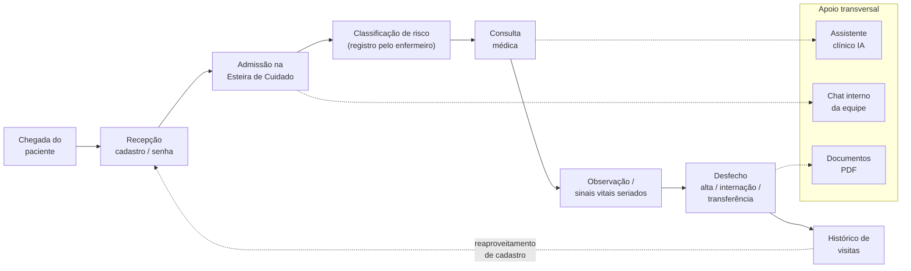

### 2.2 Módulos funcionais entregues

| Módulo | Estado | Rota frontend | Módulo backend |
|---|---|---|---|
| Autenticação e sessão | ✅ Implementado | `/` | `auth` |
| Cadastro e prontuário de pacientes | ✅ Implementado | `/main/pacientes` | `patients` |
| Sinais vitais seriados + gráficos | ✅ Implementado | `/main` | `sinais-vitais` |
| Esteira de Cuidado (Kanban) | ✅ Implementado | `/main/alertas` | `fila` |
| Triagem mobile | ✅ Implementado | `/mobile` | `fila`, `patients` |
| Assistente clínico de IA + áudio | ✅ Implementado | `/main/monitor` | `ai` |
| Chat interno tempo real | ✅ Implementado | `/chat` | `chat` |
| Histórico de visitas | ✅ Implementado | `/main/pacientes` (aba) | `visitas` |
| Exportação de prontuário PDF | ✅ Implementado (client-side) | `/main/exportar` | — |
| Política de dados / termos LGPD | ✅ Implementado | `/main/politica` | — |
| Notificações persistentes | ⛔ Não implementado | — | — |
| PDF server-side | ⛔ Não implementado | — | — |
| Trilha de auditoria (`audit_logs`) | ⛔ Não implementado | — | — |

---

## 3. Stakeholders e Atores

| Ator | Tipo | Papel no sistema | Responsabilidade principal |
|---|---|---|---|
| Recepcionista | Humano primário | `recepcionista` | Cadastro reduzido, emissão de senha, admissão na fila |
| Enfermeiro | Humano primário | `enfermeiro` | Registro da classificação de risco, registro de sinais vitais |
| Médico | Humano primário | `medico` | Consulta, conduta, desfecho, remoção da fila |
| Coordenação / Gestão | Humano secundário | — | Consome indicadores e histórico (via prontuário/PDF) |
| Groq API | Sistema externo | — | LLM de apoio clínico e transcrição de fala (Whisper) |
| PostgreSQL | Sistema externo | — | Persistência transacional |

### 3.1 Matriz de permissões (RBAC efetiva no código)

| Operação | Médico | Enfermeiro | Recepcionista | Origem da regra |
|---|:--:|:--:|:--:|---|
| `POST /login` | ✅ | ✅ | ✅ | `@Public()` |
| Listar pacientes | ✅ | ✅ | ✅ | `@Roles` no controller |
| Criar paciente | ✅ | ✅ | ✅ | `@Roles` no controller |
| Ver prontuário detalhado | ✅ | ✅ | ⛔ | `@Roles('medico','enfermeiro')` |
| Editar paciente | ✅ | ✅ | ⛔ | `@Roles('medico','enfermeiro')` |
| Registrar sinais vitais | ✅ | ✅ | ⛔ | `@Roles('medico','enfermeiro')` |
| Consultar sinais vitais | ✅ | ✅ | ⛔ | `@Roles('medico','enfermeiro')` |
| Listar fila | ✅ | ✅ | ✅ | `@Roles` no controller |
| Admitir na fila | ✅ | ✅ | ✅ | `@Roles` no controller |
| Avançar status na fila | ✅ | ✅ | ⛔ | `@Roles('medico','enfermeiro')` |
| Remover da fila | ✅ | ⛔ | ⛔ | `@Roles('medico')` |
| Histórico de visitas | ✅ | ✅ | ✅ | ⚠️ apenas JWT — sem `@Roles` |
| Fechar visita | ✅ | ✅ | ✅ | ⚠️ apenas JWT — sem `@Roles` |
| Assistente de IA | ✅ | ✅ | ⛔ | `@Roles('medico','enfermeiro')` |
| Chat interno | ✅ | ✅ | ✅ | Apenas JWT (por decisão de projeto) |

> ⚠️ As duas linhas de visitas são desvios de política documentados em [DEB-02](#13-débito-técnico-e-defeitos-identificados).

---

## 4. Requisitos

### 4.1 Requisitos Funcionais

| ID | Requisito | Prioridade | Ator | Verificação no código |
|---|---|:--:|---|---|
| RF-01 | Autenticar profissional por e-mail e senha, retornando token JWT com `id`, `nome`, `role` | Alta | Todos | `auth.service.ts` |
| RF-02 | Limitar tentativas de login a 10 por 15 min por IP em produção | Alta | — | `auth.controller.ts` (`@Throttle`) |
| RF-03 | Encerrar sessão automaticamente ao expirar o token | Alta | Todos | `services/api.ts` (interceptors) |
| RF-04 | Cadastrar paciente com CPF único de 11 dígitos | Alta | Todos | `create-patient.service.ts` |
| RF-05 | Impedir cadastro duplicado por CPF | Alta | Todos | `create-patient.service.ts` |
| RF-06 | Exibir prontuário com dados pessoais, alergias, medicamentos e anamnese | Alta | Médico, Enfermeiro | `show-patient.service.ts` |
| RF-07 | Atualizar parcialmente o prontuário | Média | Médico, Enfermeiro | `update-patient.service.ts` |
| RF-08 | Registrar medição de sinais vitais (FC, SpO₂, PA, temperatura) com marca temporal | Alta | Médico, Enfermeiro | `create-sinais-vitais.service.ts` |
| RF-09 | Retornar as 12 medições mais recentes para o painel | Alta | Médico, Enfermeiro | `get-current-vitals.service.ts` |
| RF-10 | Retornar histórico completo de sinais vitais | Média | Médico, Enfermeiro | `get-vitals-history.service.ts` |
| RF-11 | Classificar automaticamente o estado clínico em `critical`/`warning`/`normal` a partir da última medição | Alta | Médico, Enfermeiro | `utils/vitalStatus.ts` |
| RF-12 | Admitir paciente na Esteira de Cuidado gerando senha de atendimento | Alta | Todos | `create-fila.service.ts` |
| RF-13 | Impedir que o mesmo paciente ocupe duas posições na fila | Alta | Todos | `create-fila.service.ts` |
| RF-14 | Avançar o paciente pelos estados do fluxo de atendimento | Alta | Médico, Enfermeiro | `update-fila.service.ts` |
| RF-15 | Registrar a classificação de risco atribuída pelo enfermeiro (5 cores, decisão de projeto do protótipo) | Alta | Enfermeiro | `Alerts`, `MobileTriage` |
| RF-16 | Remover paciente da fila | Média | Médico | `delete-fila.service.ts` |
| RF-17 | Abrir visita automaticamente ao admitir o paciente na fila | Alta | — | `create-fila.service.ts` |
| RF-18 | Fechar visita registrando desfecho, alta e gravidade | Alta | — | `close-visita.service.ts` |
| RF-19 | Reutilizar visita ativa em vez de duplicar registro | Alta | — | `create-visita.service.ts` |
| RF-20 | Listar histórico de visitas do paciente com total | Média | Médico, Enfermeiro | `list-visitas-by-patient.service.ts` |
| RF-21 | Consultar assistente clínico de IA com contexto do paciente | Média | Médico, Enfermeiro | `clinical-chat.service.ts` |
| RF-22 | Destacar risco de alergia nas condutas sugeridas pela IA | Alta | Médico, Enfermeiro | `buildSystemPrompt()` |
| RF-23 | Transcrever áudio (até 25 MB) para texto em português | Média | Médico, Enfermeiro | `audio-transcription.service.ts` |
| RF-24 | Listar contatos internos (todos os usuários exceto o próprio) | Média | Todos | `list-contacts.service.ts` |
| RF-25 | Manter conversa de grupo geral com todos os profissionais | Média | Todos | migration `CreateChat` |
| RF-26 | Abrir ou recuperar conversa direta 1:1 idempotentemente | Média | Todos | `open-direct-conversation.service.ts` |
| RF-27 | Entregar mensagem em tempo real a todos os participantes | Alta | Todos | `chat.gateway.ts` |
| RF-28 | Marcar mensagem como `normal` ou `urgente` | Baixa | Todos | `send-message.dto.ts` |
| RF-29 | Contar mensagens não lidas por conversa | Média | Todos | `typeorm-chat.repository.ts` |
| RF-30 | Bloquear leitura/envio a não participante da conversa | Alta | — | `list-messages.service.ts`, `send-message.service.ts` |
| RF-31 | Manter mensagens imutáveis (sem update/delete) | Alta | — | `message.entity.ts` (por design) |
| RF-32 | Exportar prontuário do paciente em PDF | Média | Médico, Enfermeiro | `pages/ExportPDF` |
| RF-33 | Emitir Guia de Alta / Prescrição em PDF | Média | Médico | `Alerts/index.tsx` |
| RF-34 | Exigir aceite de termos de uso no primeiro acesso | Alta | Todos | `TermosUsoModal` |
| RF-35 | Disponibilizar política de tratamento de dados com download | Alta | Todos | `PoliticaDados`, `gerarPDFPolitica.ts` |
| RF-36 | Oferecer trilha de triagem otimizada para mobile | Média | Enfermeiro, Recepcionista | `MobileTriage`, `useMobile` |
| RF-37 | Filtrar navegação lateral conforme o papel do usuário | Alta | Todos | `SideBar` + `RoleRoute` |

### 4.2 Requisitos Não Funcionais

| ID | Categoria | Requisito | Como é atendido |
|---|---|---|---|
| RNF-01 | Segurança | Autenticação obrigatória por padrão; exceções explícitas | `JwtAuthGuard` como `APP_GUARD` global + `@Public()` |
| RNF-02 | Segurança | Autorização por papel aplicada de forma declarativa | `RolesGuard` global + `@Roles()` |
| RNF-03 | Segurança | Senhas armazenadas com hash bcrypt, custo 12 | `seed.ts`, `bcrypt.compare` |
| RNF-04 | Segurança | Falha rápida no boot se `SECRET_KEY` ausente | `env.validation.ts` |
| RNF-05 | Segurança | Cabeçalhos HTTP endurecidos | `helmet()` |
| RNF-06 | Segurança | CORS restrito por ambiente (allowlist em produção) | `main.ts` |
| RNF-07 | Segurança | Payload limitado a 10 KB (mitigação de DoS) | `json({ limit: '10kb' })` |
| RNF-08 | Segurança | Rejeição de campos desconhecidos no corpo da requisição | `ValidationPipe({ whitelist: true })` |
| RNF-09 | Segurança | Validação de UUID em todos os parâmetros de rota | `ParseUUIDPipe` |
| RNF-10 | Segurança | Rate limit global de 100 req / 15 min | `ThrottlerModule.forRoot` |
| RNF-11 | Segurança | Autenticação do WebSocket no handshake | `chat.gateway.ts` `handleConnection` |
| RNF-12 | Manutenibilidade | Separação em 4 camadas por módulo (domain/application/infrastructure/presentation) | Estrutura de `src/modules/*` |
| RNF-13 | Manutenibilidade | Inversão de dependência via tokens de repositório | `PATIENTS_REPOSITORY`, `CHAT_REPOSITORY`, etc. |
| RNF-14 | Manutenibilidade | Tipagem estrita ponta a ponta | TypeScript 5.7 (back) / 5.9 (front) |
| RNF-15 | Portabilidade | Banco versionado exclusivamente por migrations | `synchronize: false` |
| RNF-16 | Portabilidade | Suporte a `DATABASE_URL` (nuvem) ou `DB_*` (local) | `typeorm.config.ts` |
| RNF-17 | Desempenho | Consultas frequentes indexadas | `idx_messages_conversation_created`, `IDX_visitas_*` |
| RNF-18 | Desempenho | Paginação implícita por limite nas listagens de mensagens (100) e vitais (12) | Services correspondentes |
| RNF-19 | Desempenho | Denormalização de `sender_nome`/`sender_role` para evitar join no chat | `messages` (migration) |
| RNF-20 | Usabilidade | Interface responsiva com trilha mobile dedicada | `AppShell`, `useMobile` |
| RNF-21 | Usabilidade | Identidade visual e tipografia centralizadas em tema | `theme.ts` |
| RNF-22 | Confiabilidade | Reconexão automática do WebSocket com backoff | `chatService.ts` (`reconnectionDelayMax: 10000`) |
| RNF-23 | Confiabilidade | Envio de mensagem com ACK e degradação para REST | `chatService.sendMessage` |
| RNF-24 | Confiabilidade | Deduplicação de mensagens entre ACK e broadcast | `seenIds: Set<string>` |
| RNF-25 | Confiabilidade | Timeout de 30 s nas chamadas ao provedor de IA | `axios timeout` |
| RNF-26 | Conformidade | Nenhum dado de paciente trafega por plataforma de terceiros | Decisão de arquitetura (Telegram descartado) |
| RNF-27 | Conformidade | Aceite de termos e política de dados acessível | `TermosUsoModal`, `PoliticaDados` |
| RNF-28 | Observabilidade | Log de SQL habilitado fora de produção | `logging: !isProduction` |

---

## 5. Casos de Uso

### 5.1 Diagrama de casos de uso

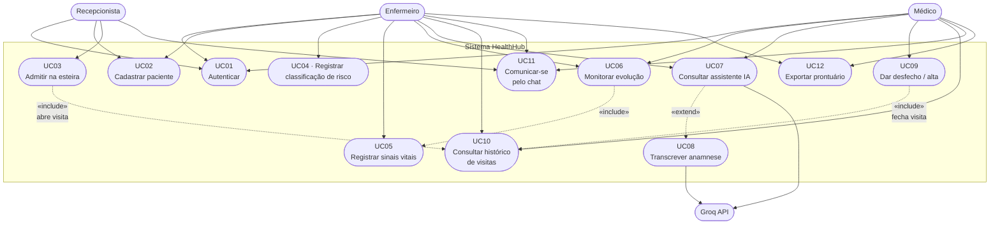

### 5.2 Especificação detalhada — UC03 · Admitir paciente na Esteira de Cuidado

| Item | Descrição |
|---|---|
| **Identificador** | UC03 |
| **Atores** | Recepcionista, Enfermeiro, Médico |
| **Objetivo** | Colocar um paciente cadastrado na fila de atendimento e abrir seu registro de visita |
| **Pré-condições** | Usuário autenticado com token válido; paciente existente no cadastro |
| **Pós-condições** | Registro em `fila_pacientes` com status `Aguardando Triagem`; visita ativa em `visitas` com desfecho `Em Atendimento` |
| **Gatilho** | Chegada física do paciente à recepção |

**Fluxo principal**

1. Usuário abre a Esteira de Cuidado (`/main/alertas`) ou a triagem mobile.
2. Usuário aciona *Admitir* e o sistema lista todos os pacientes do banco — inclusive os que já receberam alta.
3. Usuário seleciona o paciente.
4. O sistema gera senha sequencial (`PR-001`, `REC-001`) e a hora local de chegada.
5. O sistema envia `POST /fila` com `paciente_id`, `nome`, `idade`, `senha`, `chegada`, `status`.
6. O backend valida o DTO e verifica ausência prévia do paciente na fila.
7. O backend persiste a entrada na fila.
8. O backend abre uma visita (ou reaproveita a visita ativa, se houver).
9. O sistema retorna a entrada e o Kanban recebe o cartão na coluna *Aguardando Triagem*.

**Fluxos alternativos**

| Código | Condição | Tratamento |
|---|---|---|
| A1 | Paciente já está na fila | `400` — "Paciente já está na fila de atendimento." |
| A2 | `paciente_id` não é UUID | `400` — falha de validação do DTO |
| A3 | Token expirado | `401` + logout automático no frontend |
| A4 | Paciente ainda não cadastrado | Estende para UC02 (cadastro na hora) |
| A5 | Paciente possui visita ativa aberta | Visita existente é reutilizada, sem duplicar registro |

### 5.3 Especificação detalhada — UC04 · Registrar classificação de risco

| Item | Descrição |
|---|---|
| **Identificador** | UC04 |
| **Ator** | Enfermeiro |
| **Objetivo** | Classificar a gravidade do paciente e definir a prioridade de atendimento |
| **Pré-condições** | Paciente na fila com status `Aguardando Triagem` |
| **Pós-condições** | Status `Aguardando Atendimento` e `gravidade` gravada |

**Fluxo principal**

1. Enfermeiro move o cartão para *Em Triagem (Enfermeiro)*.
2. Enfermeiro registra sinais vitais (UC05).
3. Enfermeiro escolhe um dos cinco níveis de gravidade.
4. O sistema envia `PUT /fila/:id` com `status` e `gravidade`.
5. O cartão passa a *Aguardando Atendimento* com a cor da gravidade.

**Regras de negócio**

A escala tem cinco cores, em ordem de prioridade: Vermelho, Laranja, Amarelo, Verde e Azul. As cinco cores são uma decisão de projeto do protótipo (compatível com a recomendação mínima de quatro níveis do manual do Ministério da Saúde de 2009), não um padrão oficial. A cor é escolhida manualmente pelo enfermeiro; o sistema não classifica, não sugere prioridade e não controla prazos, e não há tempo-alvo associado às cores.

---

## 6. Arquitetura do Sistema

### 6.1 Estilo arquitetural

| Aspecto | Decisão |
|---|---|
| Estilo geral | Cliente-servidor em duas camadas de execução, comunicação REST + WebSocket |
| Organização do backend | **Modular monolith** com **Clean Architecture** por módulo |
| Padrões aplicados | Repository, Dependency Injection, Service Layer, DTO, Guard/Interceptor (AOP), Gateway, Singleton (`chatService`), Observer (listeners de mensagem), Provider/Context (frontend) |
| Direção das dependências | `presentation → application → domain ← infrastructure` |
| Acoplamento com ORM | Isolado na camada `infrastructure` por trás de interfaces em `domain` |

### 6.2 Diagrama de contexto (C4 — Nível 1)

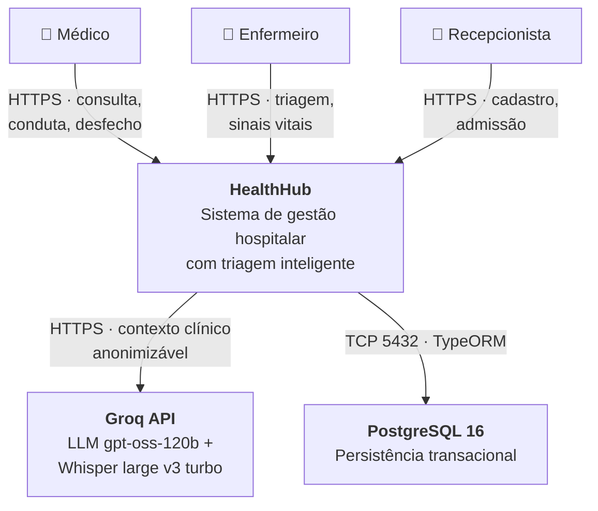

### 6.3 Diagrama de contêineres (C4 — Nível 2)

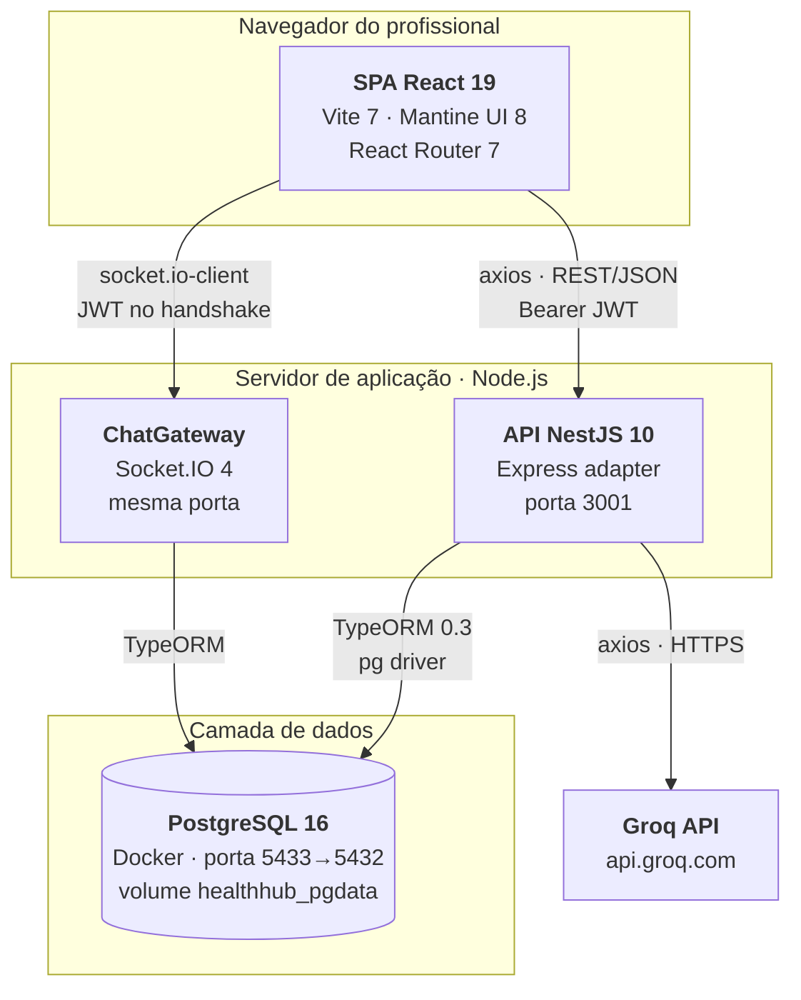

### 6.4 Diagrama de componentes do backend (C4 — Nível 3)

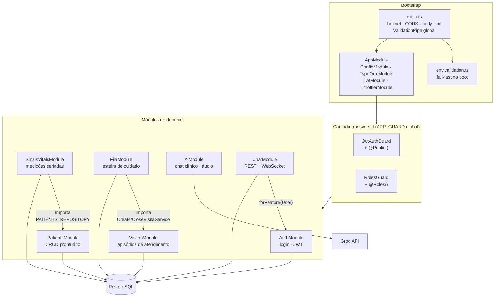

### 6.5 Camadas internas de um módulo

Todos os módulos de domínio seguem exatamente a mesma decomposição. Exemplo com `patients`:

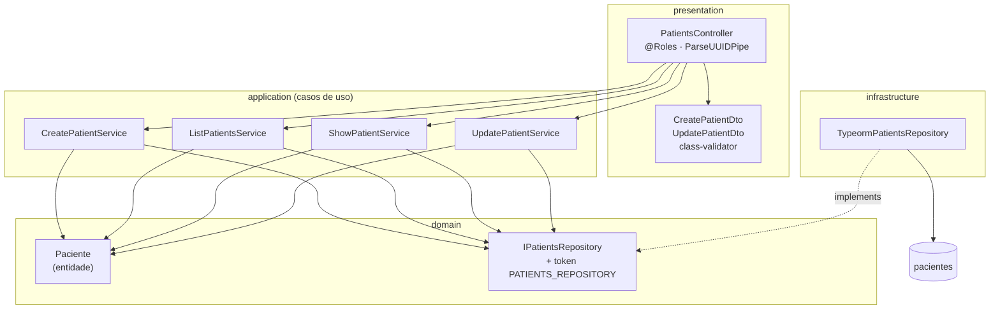

**Consequência arquitetural:** a camada `application` nunca importa TypeORM. Trocar o ORM ou o banco exige reescrever apenas `infrastructure/`.

### 6.6 Arquitetura do frontend

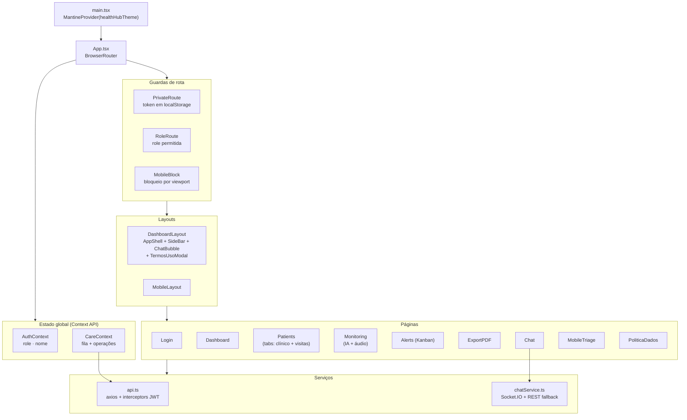

**Padrão de segurança no cliente:** o interceptor de requisição decodifica o JWT, compara `exp` com o relógio local e, se expirado, limpa `localStorage` e redireciona para `/` antes de a requisição sair. O interceptor de resposta repete a limpeza em qualquer `401` que não venha de `/login`.

---

## 7. Modelo de Domínio e Diagrama de Classes

### 7.1 Diagrama de classes — entidades de domínio

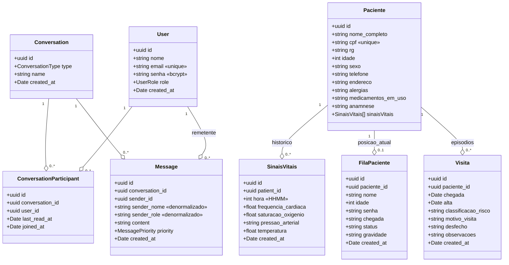

### 7.2 Diagrama de classes — camada de aplicação do módulo Fila

Ilustra a inversão de dependência e o acoplamento entre módulos (`fila` → `visitas`):

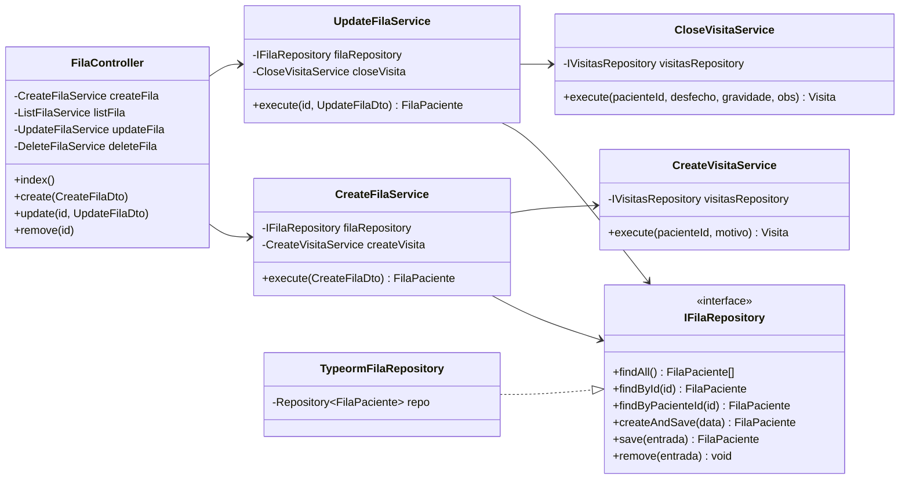

### 7.3 Regras de negócio invariantes

| ID | Invariante | Onde é garantida |
|---|---|---|
| RN-01 | CPF é único no cadastro de pacientes | `UNIQUE` no banco + verificação em `CreatePatientService` |
| RN-02 | Um paciente ocupa no máximo uma posição na fila | `findByPacienteId` em `CreateFilaService` |
| RN-03 | Um paciente possui no máximo uma visita ativa | `findActiveByPacienteId` em `CreateVisitaService` |
| RN-04 | Visita ativa ⇔ `alta IS NULL AND desfecho = 'Em Atendimento'` | Cláusula do repositório de visitas |
| RN-05 | Mensagens são imutáveis | Ausência deliberada de operações de update/delete |
| RN-06 | Só participante lê ou escreve em conversa | `isParticipant()` em todos os casos de uso do chat |
| RN-07 | Toda conversa do tipo `group` inclui implicitamente todos os usuários | `isParticipant` retorna `true` para `type = 'group'` |
| RN-08 | Conversa direta entre A e B é única | `findDirectConversation` antes de criar |
| RN-09 | `last_read_at` usa o relógio do banco, não do Node | `set({ last_read_at: () => 'now()' })` — evita erro de contagem por fuso |
| RN-10 | Remetente já leu sua própria mensagem | `markAsRead` no fim de `SendMessageService` |
| RN-11 | Exclusão de paciente propaga em cascata para vitais, fila e visitas | `ON DELETE CASCADE` nas FKs |

---

## 8. Modelo de Dados

### 8.1 DER Conceitual (modelo de entidades de negócio)

Visão de alto nível, sem atributos nem chaves — apenas as entidades do domínio hospitalar e como se relacionam.

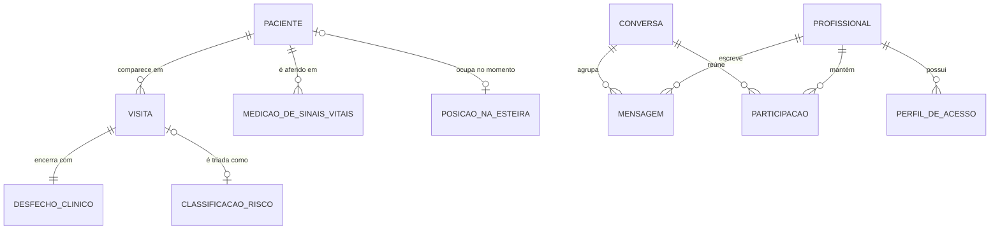

**Leitura das cardinalidades conceituais**

| Relacionamento | Cardinalidade | Regra de negócio correspondente |
|---|---|---|
| Paciente → Visita | 1 : 0..N | Um paciente acumula vários episódios ao longo do tempo; no máximo **um** ativo por vez (RN-03) |
| Paciente → Medição | 1 : 0..N | Histórico seriado permite ver evolução, não só uma foto |
| Paciente → Posição na esteira | 1 : 0..1 | Um paciente ocupa no máximo uma posição na fila (RN-02) |
| Visita → Desfecho | 1 : 1 | Toda visita tem desfecho; nasce como `Em Atendimento` |
| Visita → Classificação | 1 : 0..1 | A gravidade só existe depois da triagem |
| Profissional → Mensagem | 1 : 0..N | Autoria imutável, base do rastro auditável (RN-05) |
| Conversa ↔ Profissional | N : N (via Participação) | Resolvida pela entidade associativa `PARTICIPACAO` |

> ⚠️ No modelo conceitual, `DESFECHO_CLINICO` e `CLASSIFICACAO_RISCO` aparecem como entidades porque são **domínios de valor com semântica clínica**. Na implementação atual foram reduzidos a colunas `varchar` sem tabela de referência nem `CHECK` — desvio registrado em [DEB-19](#13-débito-técnico-e-defeitos-identificados).

### 8.2 DER Lógico completo (esquema implementado)

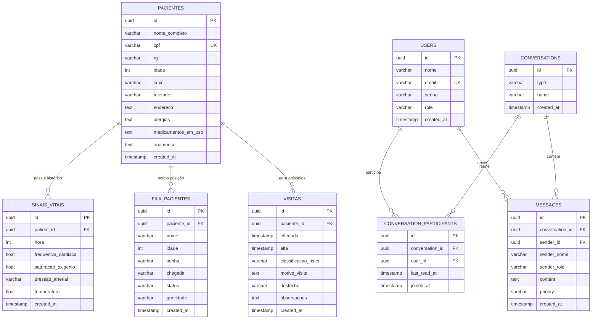

### 8.3 DER por subsistema

O esquema divide-se em dois agregados que **não compartilham nenhuma chave estrangeira entre si**. Essa separação é intencional: o subsistema de comunicação pode evoluir (ou ser extraído para outro serviço) sem tocar no núcleo assistencial.

#### 8.3.1 Subsistema Assistencial — núcleo clínico

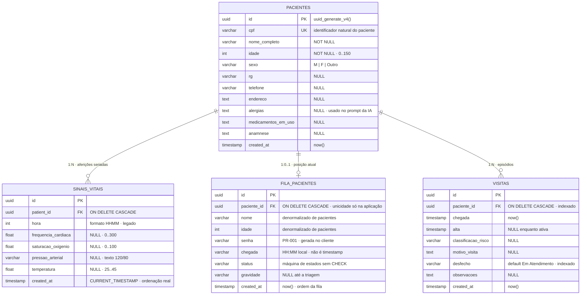

**Ponto de atenção do modelo:** `FILA_PACIENTES` guarda `nome` e `idade` copiados de `PACIENTES`. É denormalização **não justificada** (diferente da de `MESSAGES`, que é deliberada) — a fila poderia obter esses campos por join, e a cópia permite divergência se o cadastro for corrigido durante o atendimento. Ver [DEB-20](#13-débito-técnico-e-defeitos-identificados).

#### 8.3.2 Subsistema de Comunicação — chat interno

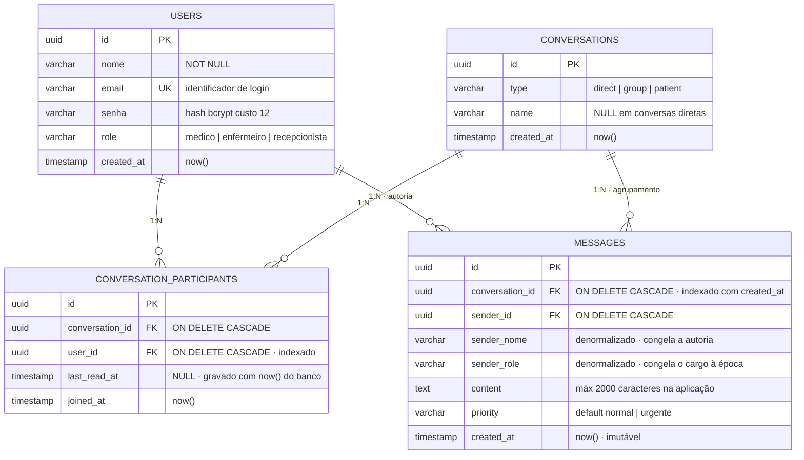

`CONVERSATION_PARTICIPANTS` é a **entidade associativa** que resolve o N:N entre `USERS` e `CONVERSATIONS`, e carrega o atributo próprio `last_read_at` — é ele que permite calcular mensagens não lidas sem tabela extra de leitura por mensagem.

**Exceção de modelagem:** conversas do tipo `group` têm participação **implícita**. `isParticipant()` retorna verdadeiro para qualquer usuário sem consultar `CONVERSATION_PARTICIPANTS`, e a linha só é criada sob demanda para armazenar `last_read_at` (ADR-06). Ou seja, a integridade referencial descreve o caso `direct`; o caso `group` é resolvido em código.

### 8.4 Modelo físico — constraints e integridade

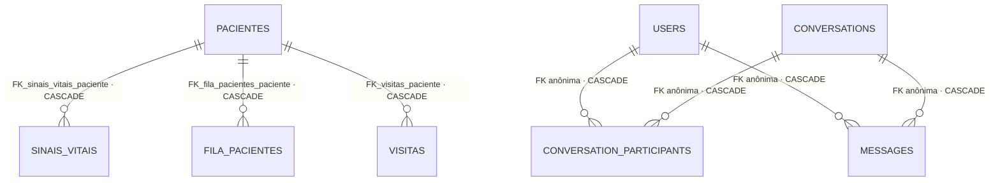

| Constraint | Tabela | Definição | Efeito |
|---|---|---|---|
| `PK` (7×) | todas | `uuid` com `uuid_generate_v4()` | Extensão `uuid-ossp` habilitada por migration |
| `UK cpf` | `pacientes` | `UNIQUE` | Garante RN-01 no banco, não só na aplicação |
| `UK email` | `users` | `UNIQUE` | Identificador de login |
| `UNIQUE (conversation_id, user_id)` | `conversation_participants` | composta | Impede participação duplicada |
| `FK_sinais_vitais_paciente` | `sinais_vitais` | `CASCADE` | Excluir paciente remove o histórico de aferições |
| `FK_fila_pacientes_paciente` | `fila_pacientes` | `CASCADE` | Excluir paciente o retira da esteira |
| `FK_visitas_paciente` | `visitas` | `CASCADE` | Excluir paciente remove os episódios |
| FKs do chat (4×) | `conversation_participants`, `messages` | `CASCADE` | Excluir conversa ou usuário limpa dependências |
| `DEFAULT 'Em Atendimento'` | `visitas.desfecho` | default | Sentinela de visita aberta |
| `DEFAULT 'normal'` | `messages.priority` | default | Prioridade padrão |

**Ausências deliberadas ou pendentes**

| O que não existe | Onde a regra vive hoje | Risco |
|---|---|---|
| `CHECK` em `fila_pacientes.status` | `PatientStatus` no TypeScript | Escrita direta no banco aceita status inválido |
| `CHECK` em `visitas.desfecho` / `classificacao_risco` | `@IsIn` no `CloseVisitaDto` | Idem |
| `CHECK` em `users.role` | Tipo `UserRole` | Idem |
| `UNIQUE (paciente_id)` em `fila_pacientes` | `findByPacienteId` no service | Corrida entre duas admissões simultâneas pode duplicar |
| Índice único parcial de visita ativa | `findActiveByPacienteId` | Corrida pode abrir duas visitas ativas |
| `NOT NULL` explícito em colunas obrigatórias | Inferido pelo TypeORM | — |

> Um `CREATE UNIQUE INDEX ... ON visitas (paciente_id) WHERE alta IS NULL` transformaria RN-03 em garantia do banco, eliminando a janela de corrida.

### 8.5 Normalização

| Forma normal | Situação | Observação |
|---|---|---|
| **1FN** | ✅ Atendida | Todos os atributos são atômicos — com a ressalva de `pressao_arterial`, que é um valor composto (sistólica/diastólica) armazenado como texto |
| **2FN** | ✅ Atendida | Todas as chaves primárias são simples (`uuid`); não há dependência parcial possível |
| **3FN** | ⚠️ Violada de propósito em 2 pontos | `messages.sender_nome`/`sender_role` dependem de `sender_id`, não da PK; `fila_pacientes.nome`/`idade` dependem de `paciente_id` |

**As duas violações têm naturezas opostas:**

- **`messages`** — denormalização **correta**. A mensagem é um registro histórico imutável: se o cargo do profissional mudar amanhã, a mensagem de ontem deve continuar mostrando o cargo da época. Congelar o dado é o comportamento desejado para auditoria (ADR-04), e ainda elimina o join na listagem.
- **`fila_pacientes`** — denormalização **acidental**. A fila é registro efêmero e o nome do paciente não deve ser congelado: corrigir um nome errado no cadastro durante o atendimento não propaga para o cartão do Kanban.

### 8.6 Dicionário de dados — decisões relevantes

| Tabela | Coluna | Tipo | Nota de projeto |
|---|---|---|---|
| `sinais_vitais` | `hora` | `int` | Formato `HHMM` (ex.: `1435`) — herança do sistema legado, preservada por compatibilidade |
| `sinais_vitais` | `pressao_arterial` | `varchar` | Texto porque a medição é composta (`120/80`), não escalar |
| `fila_pacientes` | `chegada` | `varchar` | Hora local formatada `HH:MM` gerada no cliente — **não** é timestamp |
| `fila_pacientes` | `status` | `varchar` | Máquina de estados aplicada apenas na aplicação, sem `CHECK` no banco |
| `visitas` | `desfecho` | `varchar` | Default `'Em Atendimento'`; sentinela de visita aberta |
| `visitas` | `alta` | `timestamp` | `NULL` enquanto a visita está ativa |
| `messages` | `sender_nome`, `sender_role` | `varchar` | Denormalizados de propósito: mensagens são imutáveis, evita join na listagem |
| `conversation_participants` | `(conversation_id, user_id)` | `UNIQUE` | Impede participação duplicada |
| `conversations` | linha semente | — | `('group', 'Grupo Geral')` inserida pela migration |

### 8.7 Índices

| Índice | Tabela | Colunas | Consulta que atende |
|---|---|---|---|
| `idx_messages_conversation_created` | `messages` | `(conversation_id, created_at)` | Últimas 100 mensagens da conversa; última mensagem do resumo |
| `idx_participants_user` | `conversation_participants` | `(user_id)` | Conversas diretas do usuário logado |
| `IDX_visitas_paciente_id` | `visitas` | `(paciente_id)` | Histórico de visitas do paciente |
| `IDX_visitas_desfecho` | `visitas` | `(desfecho)` | Busca da visita ativa |

### 8.8 Evolução do esquema (migrations)

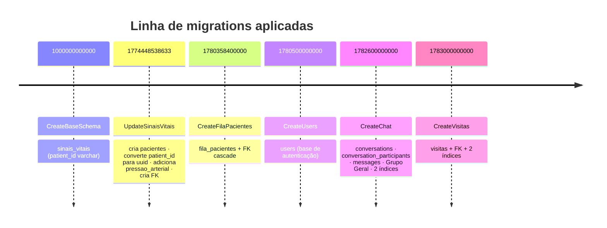

`synchronize` está desligado: **toda** mudança de esquema passa por migration versionada, o que garante reprodutibilidade entre ambientes.

---

## 9. Comportamento Dinâmico

### 9.1 Sequência — Autenticação e estabelecimento de sessão

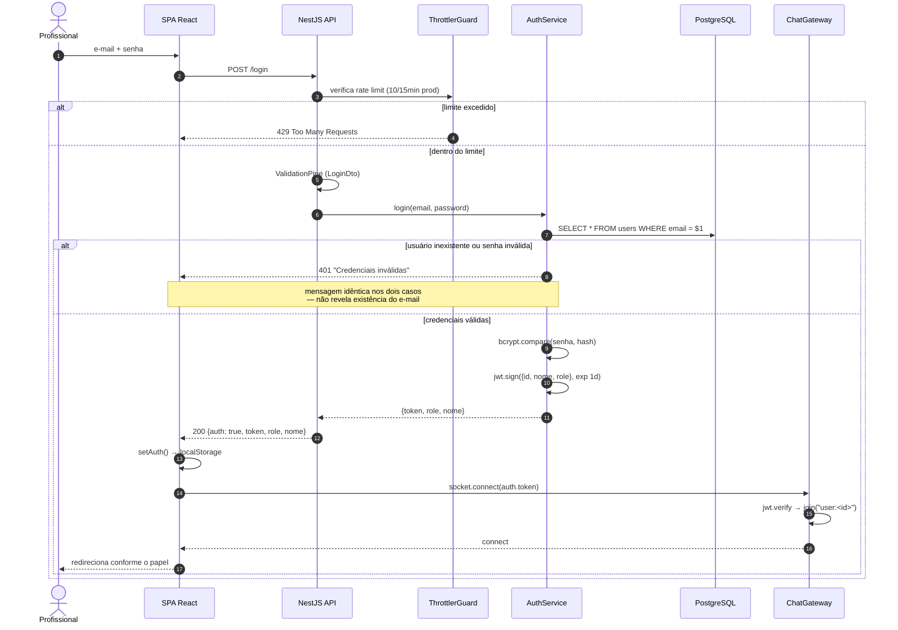

### 9.2 Sequência — Admissão na fila com abertura automática de visita

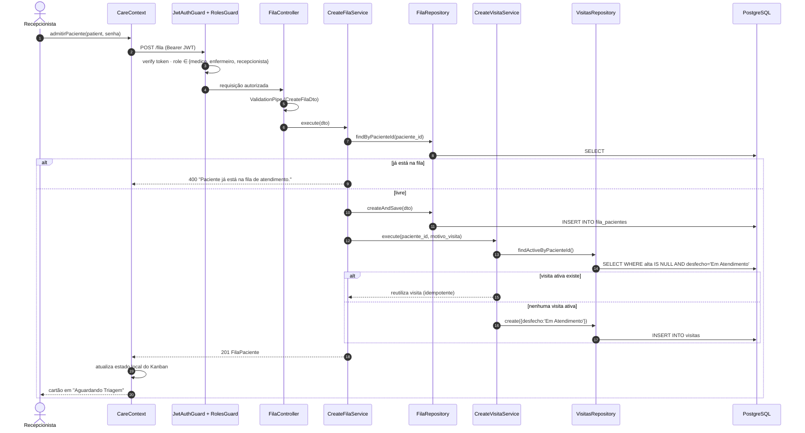

> ⚠️ **Nota de integridade:** os dois `INSERT` (fila e visita) não estão sob uma transação única. Falha no segundo deixa a fila preenchida sem visita correspondente. Ver [DEB-03](#13-débito-técnico-e-defeitos-identificados).

### 9.3 Sequência — Mensagem em tempo real com degradação para REST

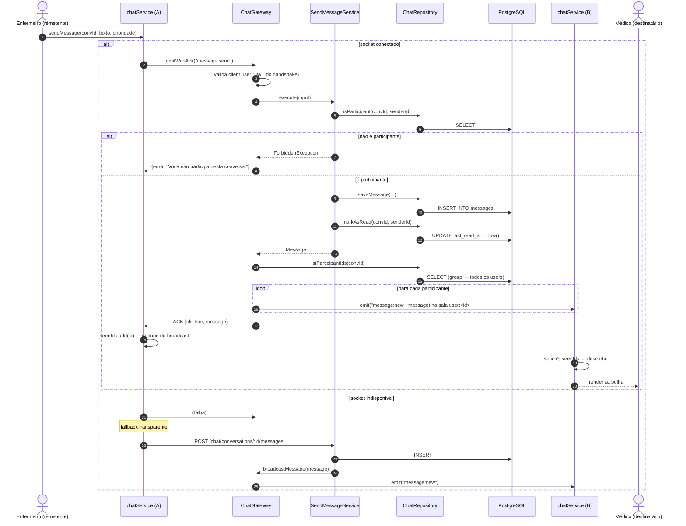

### 9.4 Sequência — Assistente clínico de IA com contexto do paciente

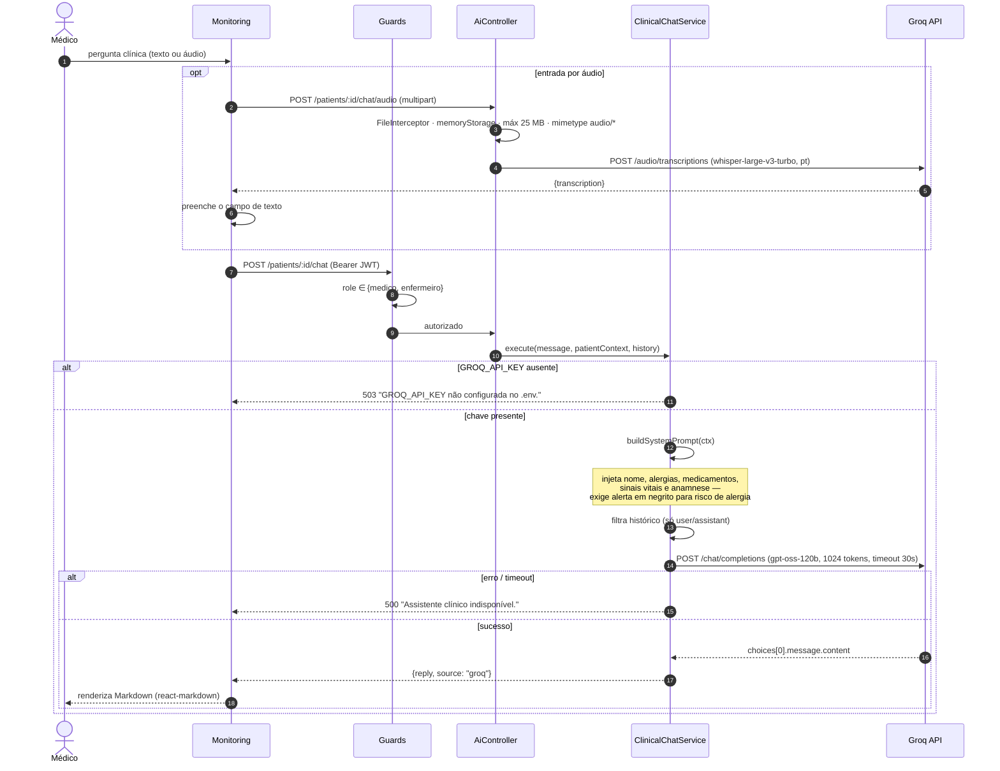

### 9.5 Máquina de estados — paciente na Esteira de Cuidado

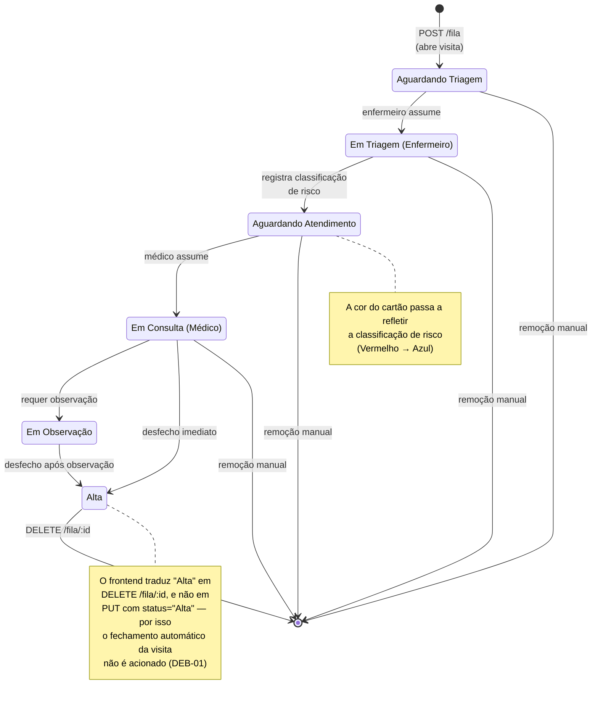

### 9.6 Máquina de estados — ciclo de vida da Visita

```mermaid
stateDiagram-v2
    [*] --> EmAtendimento : CreateVisitaService<br/>chegada = now()<br/>alta = NULL

    EmAtendimento : Em Atendimento (ativa)

    EmAtendimento --> EmAtendimento : nova admissão do<br/>mesmo paciente<br/>(reutiliza — idempotente)

    EmAtendimento --> Alta : CloseVisitaService
    EmAtendimento --> Internacao : CloseVisitaService
    EmAtendimento --> Transferencia : CloseVisitaService
    EmAtendimento --> SaidaVoluntaria : CloseVisitaService

    Alta --> [*]
    Internacao --> [*]
    Transferencia --> [*]
    SaidaVoluntaria --> [*]

    note right of EmAtendimento
        Visita ativa ⇔
        alta IS NULL
        AND desfecho = 'Em Atendimento'
    end note
```

### 9.7 Atividade — Classificação automática do estado clínico

Regra implementada em `utils/vitalStatus.ts`, aplicada sobre a **última** medição:

```mermaid
flowchart TD
    A["Última medição<br/>de sinais vitais"] --> B{"Existe<br/>medição?"}
    B -->|"não"| U["unknown<br/>cinza"]
    B -->|"sim"| C{"SpO₂ < 92%<br/>ou FC > 100 bpm<br/>ou Temp > 38,5 °C?"}
    C -->|"sim"| CR["critical<br/>vermelho"]
    C -->|"não"| D{"SpO₂ < 95%<br/>ou FC > 90 bpm<br/>ou Temp > 37,8 °C?"}
    D -->|"sim"| W["warning<br/>amarelo"]
    D -->|"não"| E{"Algum valor<br/>medido > 0?"}
    E -->|"sim"| N["normal<br/>verde"]
    E -->|"não"| U
```

Cada métrica também possui avaliador individual (`spo2Status`, `fcStatus`, `tempStatus`) usado nos cartões do painel, com os mesmos limiares.

### 9.8 Atividade — Cadeia de interceptação de uma requisição

```mermaid
flowchart TD
    REQ["Requisição HTTP"] --> HELMET["helmet()<br/>cabeçalhos de segurança"]
    HELMET --> BODY{"Payload<br/>≤ 10 KB?"}
    BODY -->|"não"| E413["413 Payload Too Large"]
    BODY -->|"sim"| CORS{"Origem na<br/>allowlist?"}
    CORS -->|"não"| EBLOCK["CORS negado<br/>(sem cabeçalho)"]
    CORS -->|"sim"| THR{"Rate limit<br/>100/15min OK?"}
    THR -->|"não"| E429["429 Too Many Requests"]
    THR -->|"sim"| PUB{"Rota marcada<br/>@Public()?"}
    PUB -->|"sim"| PIPE
    PUB -->|"não"| JWT{"Bearer token<br/>válido?"}
    JWT -->|"não"| E401["401 Unauthorized"]
    JWT -->|"sim"| ROLE{"@Roles()<br/>declarado?"}
    ROLE -->|"não"| PIPE
    ROLE -->|"sim"| CHK{"role do usuário<br/>autorizada?"}
    CHK -->|"não"| E403["403 Forbidden"]
    CHK -->|"sim"| PIPE["ValidationPipe<br/>whitelist + transform"]
    PIPE --> UUID{"ParseUUIDPipe<br/>nos params OK?"}
    UUID -->|"não"| E400["400 Bad Request"]
    UUID -->|"sim"| CTRL["Controller → Service<br/>→ Repository → DB"]
    CTRL --> RES["Resposta JSON"]
```

---

## 10. Especificação da API

Base: `http://localhost:3001` · Autenticação: `Authorization: Bearer <jwt>` em todas as rotas, exceto `POST /login`.

### 10.1 Autenticação

| Método | Rota | Papéis | Corpo | Resposta |
|---|---|---|---|---|
| `POST` | `/login` | público (throttled) | `{ email, password }` | `200 { auth, token, role, nome }` · `401` · `429` |

### 10.2 Pacientes

| Método | Rota | Papéis | Corpo | Resposta |
|---|---|---|---|---|
| `GET` | `/patients` | médico, enfermeiro, recepcionista | — | `200 Paciente[]` (com `sinaisVitais`) |
| `POST` | `/patients` | médico, enfermeiro, recepcionista | `CreatePatientDto` | `201 Paciente` · `400` CPF duplicado |
| `GET` | `/patients/:id` | médico, enfermeiro | — | `200 Paciente` (com vitais) · `404` |
| `PUT` | `/patients/:id` | médico, enfermeiro | `UpdatePatientDto` (parcial) | `200 Paciente` · `400` |

**Validação de `CreatePatientDto`**

| Campo | Regra |
|---|---|
| `nome_completo` | string, 3–150 caracteres |
| `cpf` | exatamente 11 dígitos numéricos (`/^\d{11}$/`) |
| `rg` | opcional, ≤ 20 |
| `idade` | inteiro 0–150 |
| `sexo` | ∈ `M`, `F`, `Outro` |
| `telefone` | opcional, 10 ou 11 dígitos |
| `endereco` | opcional, ≤ 300 |
| `alergias` | opcional, ≤ 1000 |
| `medicamentos_em_uso` | opcional, ≤ 1000 |
| `anamnese` | opcional, ≤ 5000 |

### 10.3 Sinais vitais

| Método | Rota | Papéis | Corpo | Resposta |
|---|---|---|---|---|
| `POST` | `/sinais/:id` | médico, enfermeiro | `CreateSinaisVitaisDto` | `201 SinaisVitais` |
| `GET` | `/sinais/:patientId/vitals` | médico, enfermeiro | — | `200 SinaisVitais[]` (histórico completo, desc.) |
| `GET` | `/patients/:id/vitals` | médico, enfermeiro | — | `200 SinaisVitais[]` (12 mais recentes) · `400` |

**Faixas aceitas:** `frequencia_cardiaca` 0–300 · `saturacao_oxigenio` 0–100 · `temperatura` 25–45 · `pressao_arterial` texto ≤ 20 · `hora` numérico (default = `HHMM` atual).

### 10.4 Esteira de Cuidado

| Método | Rota | Papéis | Corpo | Resposta |
|---|---|---|---|---|
| `GET` | `/fila` | médico, enfermeiro, recepcionista | — | `200 FilaPaciente[]` (ordem de chegada) |
| `POST` | `/fila` | médico, enfermeiro, recepcionista | `CreateFilaDto` | `201 FilaPaciente` · `400` já na fila |
| `PUT` | `/fila/:id` | médico, enfermeiro | `{ status, gravidade? }` | `200 FilaPaciente` · `404` |
| `DELETE` | `/fila/:id` | **médico** | — | `204` · `404` |

### 10.5 Visitas

| Método | Rota | Papéis | Corpo | Resposta |
|---|---|---|---|---|
| `GET` | `/patients/:id/visitas` | ⚠️ qualquer autenticado | — | `200 { visitas, total }` |
| `PATCH` | `/patients/:id/visitas/fechar` | ⚠️ qualquer autenticado | `CloseVisitaDto` | `200 Visita \| null` |

`desfecho` ∈ `Alta`, `Internacao`, `Transferencia`, `Saida Voluntaria` (default `Alta`) · `classificacao_risco` ∈ `Vermelho`, `Laranja`, `Amarelo`, `Verde`, `Azul`.

### 10.6 Inteligência artificial

| Método | Rota | Papéis | Corpo | Resposta |
|---|---|---|---|---|
| `POST` | `/patients/:id/chat` | médico, enfermeiro | `{ message, patientContext, history? }` | `200 { reply, source }` · `500` · `503` |
| `POST` | `/patients/:id/chat/audio` | médico, enfermeiro | `multipart/form-data` campo `audio` | `200 { transcription }` · `400` · `500` · `503` |

### 10.7 Chat interno

| Método | Rota | Papéis | Corpo | Resposta |
|---|---|---|---|---|
| `GET` | `/chat/contacts` | autenticado | — | `200 {id, nome, role}[]` (exclui o próprio) |
| `GET` | `/chat/conversations` | autenticado | — | `200 ConversationSummary[]` |
| `POST` | `/chat/conversations` | autenticado | `{ user_id }` | `200 Conversation` (idempotente) · `400` |
| `GET` | `/chat/conversations/:id/messages` | participante | — | `200 Message[]` (100, cronológico) · `403` |
| `POST` | `/chat/conversations/:id/messages` | participante | `{ content, priority? }` | `201 Message` · `403` |
| `POST` | `/chat/conversations/:id/read` | participante | — | `204` · `403` |

### 10.8 Protocolo WebSocket

| Direção | Evento | Carga | Semântica |
|---|---|---|---|
| handshake | `auth.token` | JWT | Falha → `error` + desconexão imediata |
| servidor | *(join implícito)* | — | Cliente entra na sala `user:<id>` |
| cliente → servidor | `message:send` | `{ conversationId, content, priority? }` | ACK `{ ok, message }` ou `{ error }`; conteúdo truncado em 2000 caracteres |
| servidor → cliente | `message:new` | `Message` | Emitido a cada participante, inclusive ao remetente |
| cliente → servidor | `conversation:read` | `{ conversationId }` | ACK `{ ok }` ou `{ error }` |

### 10.9 Convenção de erros

| Código | Uso no sistema |
|---|---|
| `400` | Falha de validação de DTO, CPF/fila duplicados, UUID inválido |
| `401` | Token ausente, inválido ou expirado; credenciais inválidas |
| `403` | Papel não autorizado; não participante da conversa |
| `404` | Paciente, entrada de fila ou recurso inexistente |
| `429` | Rate limit global ou de login excedido |
| `500` | Falha do provedor de IA |
| `503` | `GROQ_API_KEY` não configurada |

---

## 11. Segurança, Privacidade e LGPD

### 11.1 Arquitetura de segurança em profundidade

```mermaid
flowchart TB
    subgraph L1["Camada 1 — Transporte e cabeçalhos"]
        A1["helmet() · CSP, HSTS, noSniff"]
        A2["CORS por allowlist de ambiente"]
        A3["Limite de payload 10 KB"]
    end
    subgraph L2["Camada 2 — Abuso"]
        B1["ThrottlerModule global · 100 req/15 min"]
        B2["Throttle de login · 10 tentativas/15 min (prod)"]
    end
    subgraph L3["Camada 3 — Autenticação"]
        C1["JwtAuthGuard global (deny-by-default)"]
        C2["@Public() como exceção explícita"]
        C3["JWT HS256 · expiração 1 dia"]
        C4["Handshake do WebSocket autenticado"]
    end
    subgraph L4["Camada 4 — Autorização"]
        D1["RolesGuard global + @Roles()"]
        D2["isParticipant() no chat (autorização por recurso)"]
    end
    subgraph L5["Camada 5 — Entrada"]
        E1["ValidationPipe whitelist (descarta campos extras)"]
        E2["class-validator com limites de tamanho e faixa"]
        E3["ParseUUIDPipe em todos os :id"]
        E4["FileFilter · apenas audio/* · 25 MB"]
    end
    subgraph L6["Camada 6 — Dados"]
        F1["bcrypt custo 12"]
        F2["Parametrização de queries pelo TypeORM"]
        F3["ON DELETE CASCADE (integridade referencial)"]
        F4["Segredos apenas em variáveis de ambiente"]
    end
    subgraph L7["Camada 7 — Cliente"]
        G1["Verificação de exp antes de cada requisição"]
        G2["Logout automático em 401"]
        G3["Guardas de rota por papel"]
    end

    L1 --> L2 --> L3 --> L4 --> L5 --> L6
    L7 -.->|"defesa complementar,<br/>não substitui o servidor"| L3
```

### 11.2 Controles implementados

| Controle | Implementação | Arquivo |
|---|---|---|
| Deny-by-default de autenticação | `APP_GUARD` global; rota pública requer decorator | `app.module.ts` |
| Fail-fast de configuração | Boot aborta sem `SECRET_KEY` | `env.validation.ts` |
| Degradação avisada de IA | Log de aviso e `503` sem `GROQ_API_KEY` | `env.validation.ts`, `clinical-chat.service.ts` |
| Mensagem de erro uniforme no login | "Credenciais inválidas" para usuário inexistente e senha errada | `auth.service.ts` |
| Semente sem senha em código | Exige `SEED_*_SENHA`; aborta se ausente | `seed.ts` |
| Logs de SQL só fora de produção | `logging: !isProduction` | `typeorm.config.ts` |
| Truncamento de conteúdo no gateway | `.slice(0, 2000)` | `chat.gateway.ts` |
| Aceite de termos | Modal bloqueante; recusa faz logout | `TermosUsoModal`, `Layouts/index.tsx` |

### 11.3 Conformidade LGPD

| Princípio (Art. 6º) | Aplicação no HealthHub |
|---|---|
| Finalidade | Dados coletados exclusivamente para assistência à saúde |
| Necessidade | Recepcionista opera formulário reduzido e não acessa dados clínicos |
| Segurança | Criptografia de senha, RBAC, validação, cabeçalhos endurecidos |
| Transparência | Política de dados consultável e exportável em PDF |
| Não transferência a terceiros | Integração com Telegram **descartada por decisão de arquitetura**; comunicação 100% interna |
| Prevenção | Rate limit, limite de payload, expiração de sessão |

**Lacunas de conformidade abertas** (ver seção 13): ausência de `audit_logs`, de mecanismo de anonimização/eliminação a pedido do titular, e trânsito de contexto clínico identificável para a Groq API.

### 11.4 Análise de ameaças (STRIDE resumido)

| Ameaça | Vetor | Mitigação atual | Resíduo |
|---|---|---|---|
| **S**poofing | Roubo de JWT no `localStorage` | Expiração de 1 dia; verificação de `exp` | XSS expõe o token — cookie `HttpOnly` seria mais forte |
| **T**ampering | Alteração de payload | `whitelist: true` descarta campos não declarados | — |
| **R**epudiation | Negar autoria de conduta | Mensagens imutáveis com autor denormalizado | Sem `audit_logs` para ações clínicas |
| **I**nfo disclosure | Acesso indevido a prontuário | RBAC por rota; recepcionista sem acesso clínico | Rotas de visita sem `@Roles` |
| **D**oS | Flood de requisições | Throttler global + limite de payload | Sem limite por usuário no WebSocket |
| **E**levation | Chamada direta à API com papel inferior | `RolesGuard` no servidor (não só no cliente) | — |

---

## 12. Qualidade, Testes e Verificação

### 12.1 Situação atual

```mermaid
flowchart LR
    subgraph HAVE["Verificação existente"]
        A["Tipagem estática<br/>TypeScript strict"]
        B["ESLint 9 + regras React Hooks<br/>(frontend)"]
        C["Validação em runtime<br/>class-validator"]
        D["Smoke test manual de WS<br/>scripts/ws-smoke-test.mjs"]
        E["Checklist manual de validação<br/>PLANO_MIGRACAO.md §9"]
    end

    subgraph MISSING["Ausente"]
        F["Testes unitários<br/>(nenhum arquivo .spec.ts)"]
        G["Testes de integração<br/>de repositórios"]
        H["Testes E2E<br/>(supertest / Playwright)"]
        I["Pipeline de CI"]
        J["Cobertura medida"]
    end

    style MISSING fill:#fee,stroke:#c33
```

Não existe nenhum arquivo `*.spec.ts` ou `*.test.ts` no repositório, nem configuração de Jest/Vitest, nem workflow de CI. A verificação hoje é **manual e por tipos**.

### 12.2 Estratégia de teste recomendada

| Nível | Alvo prioritário | Ferramenta sugerida | Por que primeiro |
|---|---|---|---|
| Unitário | `CreateFilaService`, `UpdateFilaService`, `CreateVisitaService`, `CloseVisitaService` | Jest + repositórios falsos | Concentram as regras de negócio e o acoplamento entre módulos |
| Unitário | `vitalStatus.ts` (limiares clínicos) | Vitest | Função pura, alto valor clínico, custo de teste próximo de zero |
| Unitário | `AuthService` | Jest + mock de bcrypt/JwtService | Superfície de segurança crítica |
| Integração | `TypeormChatRepository` (`unreadCount`, `findDirectConversation`) | Jest + Postgres em Testcontainers | Lógica de SQL não coberta por tipos |
| E2E API | Matriz RBAC completa da seção 3.1 | Supertest | Regressão de autorização é a falha mais custosa |
| E2E UI | Fluxo recepção → triagem → consulta → alta | Playwright | Valida a máquina de estados ponta a ponta |
| Contrato | Eventos WebSocket | socket.io-client em teste | Já existe base em `ws-smoke-test.mjs` |

### 12.3 Cenários de teste de aceitação (prontos para automação)

| ID | Cenário | Resultado esperado |
|---|---|---|
| CT-01 | Login com senha errada | `401` "Credenciais inválidas" |
| CT-02 | 11 tentativas de login em produção | 11ª retorna `429` |
| CT-03 | Recepcionista chama `GET /patients/:id` | `403` |
| CT-04 | Enfermeiro chama `DELETE /fila/:id` | `403` |
| CT-05 | Cadastro com CPF de 10 dígitos | `400` de validação |
| CT-06 | Cadastro com CPF já existente | `400` "CPF já está cadastrado" |
| CT-07 | Corpo com campo desconhecido | Campo descartado; requisição prossegue |
| CT-08 | Admitir paciente já na fila | `400` |
| CT-09 | Admissão gera exatamente uma visita ativa | `GET /patients/:id/visitas` → 1 com `Em Atendimento` |
| CT-10 | Duas admissões seguidas do mesmo paciente | Continua com 1 visita ativa (idempotência) |
| CT-11 | `PUT /fila/:id` com `status = 'Alta'` | Visita fechada com `alta` preenchida |
| CT-12 | Usuário não participante lista mensagens | `403` |
| CT-13 | Mensagem enviada por A | Chega em B via `message:new` em < 1 s |
| CT-14 | Socket sem token no handshake | Desconexão imediata com `error` |
| CT-15 | `POST /patients/:id/chat` sem `GROQ_API_KEY` | `503` |
| CT-16 | Upload de PDF no endpoint de áudio | `400` "Apenas arquivos de áudio" |
| CT-17 | Token expirado em requisição | Frontend limpa sessão e redireciona |
| CT-18 | SpO₂ = 91 na última medição | Cartão em `critical` |
| CT-19 | Temperatura = 38,0 na última medição | Cartão em `warning` |
| CT-20 | Paciente sem medições | Cartão em `unknown` |

---

## 13. Débito Técnico e Defeitos Identificados

Itens levantados por leitura do código, com severidade e correção proposta.

| ID | Severidade | Achado | Evidência | Impacto | Correção proposta |
|---|:--:|---|---|---|---|
| **DEB-01** | 🔴 Alta | **Visitas nunca são fechadas pelo fluxo de alta.** `CareContext.avançarFluxo` traduz `status = 'Alta'` em `DELETE /fila/:id`, e `DeleteFilaService` não chama `CloseVisitaService`. O código de fechamento em `UpdateFilaService` é inalcançável por esse caminho. | `context/CareContext.tsx` (`if (novoStatus === 'Alta') → api.delete`) vs. `update-fila.service.ts` (`ALTA_STATUSES`) | Toda visita permanece `Em Atendimento` com `alta = NULL`. O histórico de visitas — base declarada para o trabalho futuro de ML — nasce inconsistente. | Fechar a visita em `DeleteFilaService`, **ou** fazer o frontend enviar `PUT` com `status='Alta'` antes do `DELETE`. Preferir a primeira: mantém a regra no servidor. |
| **DEB-02** | 🟠 Média | **Rotas de visita sem `@Roles`.** `VisitasController` só é protegido pelo `JwtAuthGuard` global. | `visitas/presentation/visitas.controller.ts` | Recepcionista lê histórico clínico (gravidade, desfecho, observações) e pode fechar visita — contradiz a política aplicada em `patients`. | `@Roles('medico','enfermeiro')` na leitura e no fechamento. |
| **DEB-03** | 🟠 Média | **Admissão não é atômica.** `INSERT fila_pacientes` e `INSERT visitas` ocorrem em conexões independentes. | `create-fila.service.ts` | Falha no segundo insert deixa fila sem visita; estado precisa de reconciliação manual. | Envolver o caso de uso em `DataSource.transaction()`. |
| **DEB-04** | 🟠 Média | **`removerPaciente` exposto a papéis sem permissão.** O ícone de remoção aparece nas colunas do Kanban para qualquer papel, mas `DELETE /fila/:id` exige `medico`. | `pages/Alerts/index.tsx` vs. `fila.controller.ts` | Enfermeiro e recepcionista recebem `403` sem tratamento visível — falha silenciosa de UX. | Ocultar o controle conforme `role` e tratar `403` com aviso. |
| **DEB-05** | 🟠 Média | **URL de API fixa em código.** `http://localhost:3001` aparece literal em dois arquivos. | `services/api.ts`, `services/chatService.ts` | Impede build para homologação/produção sem editar o código. | `import.meta.env.VITE_API_URL` com fallback local. |
| **DEB-06** | 🟠 Média | **Sem trilha de auditoria.** `audit_logs` estava previsto no plano e não existe. | Ausência de migration/módulo | Acesso a prontuário e emissão de PDF não deixam rastro — fragiliza a posição LGPD e a irretratabilidade. | Interceptor NestJS gravando `(user_id, ação, recurso, timestamp, IP)`. |
| **DEB-07** | 🟠 Média | **Nenhum teste automatizado.** | Repositório sem `*.spec.ts` e sem CI | Toda regressão depende de teste manual; a matriz RBAC não tem rede de proteção. | Implementar a seção 12.2 começando por fila/visitas e pela matriz de papéis. |
| **DEB-08** | 🟡 Baixa | **Contador de senha em memória do cliente.** `let senhaCounter = 1` reinicia a cada recarga e é independente por aba. | `Alerts/index.tsx`, `MobileTriage/index.tsx` | Senhas duplicadas com dois atendentes simultâneos. | Gerar a senha no backend por sequência diária. |
| **DEB-09** | 🟡 Baixa | **`fila_pacientes.chegada` é `varchar` com hora local do cliente.** | migration `CreateFilaPacientes` | Impede cálculo confiável de tempo de espera — métrica central em pronto-atendimento. | Migrar para `timestamptz` preenchido pelo servidor. |
| **DEB-10** | 🟡 Baixa | **`sinais_vitais.hora` como inteiro `HHMM`.** | `sinais-vitais.entity.ts` | Não é ordenável entre dias; redundante com `created_at`. | Depreciar em favor de `created_at`. |
| **DEB-11** | 🟡 Baixa | **`ConversationType` inclui `'patient'` sem implementação.** | `conversation.entity.ts` | Tipo morto no domínio; sugere recurso inexistente. | Implementar a thread por paciente ou remover o valor. |
| **DEB-12** | 🟡 Baixa | **CORS do WebSocket com `origin: true`.** Aceita qualquer origem, ao contrário da allowlist do HTTP. | `chat.gateway.ts` | Inconsistência de política entre os dois canais. | Reaproveitar a mesma allowlist do `main.ts`. |
| **DEB-13** | 🟡 Baixa | **`listUserConversations` gera N+1 consultas.** `buildSummary` executa 3–4 queries por conversa. | `typeorm-chat.repository.ts` | Custo linear no número de conversas do usuário. | Consolidar em uma query com agregação/`LEFT JOIN LATERAL`. |
| **DEB-14** | 🟡 Baixa | **`result[0]` assumido como o grupo.** Se `findGroupConversation` retornar `null`, a lista fica com um elemento `undefined`. | `typeorm-chat.repository.ts` | Erro potencial no cliente em base sem a linha semente. | Tratar ausência do grupo explicitamente. |
| **DEB-15** | 🟡 Baixa | **README do backend desatualizado.** Descreve Express, "Service Layer" e porta 3333. | `HealthHub-BackEnd/Readme.md` | Documentação divergente do código (NestJS, porta 3001). | Reescrever refletindo a arquitetura atual. |
| **DEB-16** | 🟡 Baixa | **Swagger previsto e não implementado.** | Plano §3.1 vs. `package.json` | API sem documentação executável. | Adicionar `@nestjs/swagger` com decorators nos DTOs. |
| **DEB-17** | 🟡 Baixa | **`.env.example` retém chaves de Supabase/Vite não usadas.** | `.env.example` | Confunde quem configura o ambiente. | Remover as entradas obsoletas. |
| **DEB-18** | 🟡 Baixa | **PDF gerado no cliente.** Layout e dados dependem do navegador. | `pages/ExportPDF`, `Alerts` | Inconsistência entre máquinas; impede anexar PDF ao chat. | Módulo `pdf` server-side (`GET /patients/:id/pdf`). |
| **DEB-19** | 🟠 Média | **Domínios de valor sem `CHECK` nem tabela de referência.** `status`, `desfecho`, `classificacao_risco` e `role` são `varchar` livres; a regra existe só em TypeScript. | migrations vs. `@IsIn`, `PatientStatus`, `UserRole` | Escrita fora da API (script, correção manual, migration futura) grava valor inválido sem o banco reclamar; consultas analíticas ficam sujeitas a variação de grafia. | Adicionar `CHECK` nas colunas, ou tabelas de domínio com FK. O `CHECK` é suficiente e mais barato. |
| **DEB-20** | 🟡 Baixa | **Denormalização acidental em `fila_pacientes`.** `nome` e `idade` são cópias de `pacientes`, sem a justificativa histórica que `messages` tem. | migration `CreateFilaPacientes`, `CareContext.admitirPaciente` | Corrigir o nome do paciente durante o atendimento não atualiza o cartão do Kanban — dois valores divergentes na mesma tela. | Remover as colunas e obter os dados por join/`relations`. |
| **DEB-21** | 🟠 Média | **Unicidade de fila e de visita ativa garantida só na aplicação.** Não há `UNIQUE` em `fila_pacientes.paciente_id` nem índice parcial de visita aberta. | RN-02, RN-03 verificadas com `SELECT` prévio | Duas admissões simultâneas do mesmo paciente passam pela verificação antes de qualquer `INSERT` e duplicam o registro. | `UNIQUE (paciente_id)` na fila e `CREATE UNIQUE INDEX ON visitas (paciente_id) WHERE alta IS NULL`. |

### 13.1 Priorização

```mermaid
quadrantChart
    title Débito técnico — impacto vs. esforço
    x-axis "Baixo esforço" --> "Alto esforço"
    y-axis "Baixo impacto" --> "Alto impacto"
    quadrant-1 "Planejar"
    quadrant-2 "Fazer agora"
    quadrant-3 "Oportunista"
    quadrant-4 "Reavaliar"
    "DEB-01 visita nao fecha": [0.18, 0.95]
    "DEB-02 roles em visitas": [0.08, 0.72]
    "DEB-03 transacao": [0.30, 0.68]
    "DEB-04 botao sem permissao": [0.15, 0.45]
    "DEB-05 URL fixa": [0.10, 0.55]
    "DEB-06 audit logs": [0.62, 0.80]
    "DEB-07 testes": [0.85, 0.88]
    "DEB-08 senha no cliente": [0.32, 0.38]
    "DEB-09 chegada varchar": [0.42, 0.50]
    "DEB-13 N+1 no chat": [0.45, 0.30]
    "DEB-16 swagger": [0.28, 0.32]
    "DEB-18 PDF no servidor": [0.70, 0.42]
    "DEB-19 CHECK de dominio": [0.20, 0.58]
    "DEB-20 denormalizacao fila": [0.35, 0.25]
    "DEB-21 unicidade no banco": [0.16, 0.62]
```

---

## 14. Infraestrutura, Build e Implantação

### 14.1 Topologia de desenvolvimento

```mermaid
flowchart TB
    subgraph DEV["Estação de desenvolvimento · Windows"]
        subgraph NODE["Node.js"]
            VITE["Vite dev server<br/>localhost:5173<br/>npm run dev"]
            NEST["NestJS watch<br/>localhost:3001<br/>nest start --watch"]
        end
        subgraph DOCKER["Docker Desktop"]
            PG[("healthhub-db<br/>postgres:16-alpine<br/>host 5433 → 5432<br/>volume healthhub_pgdata")]
        end
    end
    GROQ["api.groq.com"]

    VITE -->|"REST + WS"| NEST
    NEST -->|"pg"| PG
    NEST -->|"HTTPS"| GROQ
```

### 14.2 Variáveis de ambiente

| Variável | Obrigatória | Efeito se ausente |
|---|:--:|---|
| `SECRET_KEY` | ✅ | **Boot aborta** |
| `DATABASE_URL` *ou* `DB_HOST`… | ⚠️ | Aviso no log; cai nos defaults locais |
| `GROQ_API_KEY` | ⛔ | Aviso; rotas de IA respondem `503` |
| `PORT` | ⛔ | Default `3001` |
| `NODE_ENV` | ⛔ | Não-produção: CORS permissivo local, log de SQL ativo |
| `ALLOWED_ORIGINS` | ⚠️ em produção | Sem origem liberada em produção |
| `SEED_*_SENHA` | ✅ para semear | `seed.ts` aborta |

### 14.3 Procedimento de implantação

```mermaid
flowchart LR
    A["git clone"] --> B["npm install<br/>(back e front)"]
    B --> C["configurar .env<br/>SECRET_KEY + DB + GROQ"]
    C --> D["docker compose up -d<br/>(PostgreSQL)"]
    D --> E["npm run migration:run"]
    E --> F["npm run seed"]
    F --> G["npm run build<br/>(back: nest build · front: tsc + vite build)"]
    G --> H["npm run start:prod<br/>+ servir dist/ do frontend"]
```

```bash
docker compose -f HealthHub-BackEnd/docker-compose.yml up -d
```

```bash
cd HealthHub-BackEnd && npm run migration:run && npm run seed
```

### 14.4 Scripts disponíveis

| Projeto | Script | Ação |
|---|---|---|
| Backend | `dev` / `start:dev` | `nest start --watch` |
| Backend | `build` | `nest build` |
| Backend | `start:prod` | `node dist/main` |
| Backend | `migration:run` / `:generate` / `:revert` | TypeORM CLI via `tsx` |
| Backend | `seed` | Cria os três usuários de papel |
| Frontend | `dev` | Vite dev server |
| Frontend | `build` | `tsc -b && vite build` |
| Frontend | `lint` | ESLint 9 |
| Frontend | `preview` | Serve o build local |

**Utilitários:** `scripts/importarPsv.ts` (importação de dataset clínico PhysioNet) e `scripts/ws-smoke-test.mjs` (verificação manual do canal WebSocket).

---

## 15. Métricas do Produto de Software

### 15.1 Tamanho

| Métrica | Backend | Frontend | Total |
|---|--:|--:|--:|
| Arquivos TypeScript | 83 | 35 | **118** |
| Linhas de código | 2.759 | 8.168 | **10.927** |
| Módulos de domínio | 7 | — | 7 |
| Entidades persistidas | 8 | — | 8 |
| Migrations | 6 | — | 6 |
| Endpoints REST | 20 | — | 20 |
| Eventos WebSocket | 3 | — | 3 |
| Casos de uso (services) | 23 | — | 23 |
| Páginas / rotas de tela | — | 9 | 9 |
| Componentes reutilizáveis | — | 11 | 11 |

### 15.2 Distribuição de complexidade no frontend

| Arquivo | Linhas | Observação |
|---|--:|---|
| `pages/ExportPDF/index.tsx` | 844 | Layout de PDF codificado imperativamente com jsPDF |
| `pages/MobileTriage/index.tsx` | 809 | Trilha mobile completa em um arquivo |
| `pages/Chat/index.tsx` | 674 | Lista de conversas + janela + painel de detalhes |
| `pages/Alerts/index.tsx` | 551 | Kanban + modais + geração de guia de alta |
| `components/TermosUsoModal/index.tsx` | 524 | Texto legal embutido no componente |
| `pages/Patients/index.tsx` | 494 | Abas de dados clínicos e histórico de visitas |

> Seis arquivos concentram ~48 % do código do frontend. É o principal indicador a favor da **Fase 2** (modularização por feature), ainda pendente no plano de migração.

### 15.3 Aderência arquitetural do backend

| Indicador | Resultado |
|---|---|
| Módulos com as 4 camadas completas | 6 de 7 (`ai` não tem `domain`/`infrastructure` — não persiste estado) |
| Casos de uso dependentes de interface, não de ORM | 23 de 23 |
| Controllers com validação por DTO em corpo mutável | 100 % |
| Rotas com `:id` usando `ParseUUIDPipe` | 100 % |
| Controllers com política de papel declarada | 6 de 7 (`visitas` pendente — DEB-02) |

---

## 16. Gestão de Configuração e Processo

### 16.1 Repositório

| Aspecto | Situação |
|---|---|
| Estrutura | Monorepo com dois pacotes independentes |
| Branch de trabalho | `master` (branch principal de referência: `main`) |
| Commits registrados | 16 (janela 27/08/2026 – 28/08/2026, após reinicialização do histórico) |
| Padrão de mensagem | Conventional Commits (`feat:`, `fix:`) |
| Segredos | `.env` fora do versionamento; `.env.example` como modelo |
| Versionamento de esquema | Exclusivamente por migrations TypeORM |

### 16.2 Ciclo de desenvolvimento adotado

Modelo **incremental orientado a fases com gates**, definido em `PLANO_MIGRACAO.md`:

```mermaid
flowchart LR
    F1["<b>Fase 1</b><br/>Backend NestJS<br/>auth · patients · vitals<br/>fila · ai"]
    G1{"Gate 1<br/>frontend legado<br/>100% funcional"}
    F2["<b>Fase 2</b><br/>Frontend modular<br/>por feature"]
    G2{"Gate 2<br/>paridade visual<br/>e funcional"}
    F3["<b>Fase 3</b><br/>Tempo real<br/>chat · notificações"]
    G3{"Gate 3<br/>mensagens entre<br/>dois navegadores"}
    F4["<b>Fase 4</b><br/>Expansão<br/>PDF server-side<br/>audit_logs"]

    F1 --> G1 --> F2 --> G2 --> F3 --> G3 --> F4

    style F1 fill:#d4edda,stroke:#28a745
    style G1 fill:#d4edda,stroke:#28a745
    style F3 fill:#fff3cd,stroke:#ffc107
    style G3 fill:#fff3cd,stroke:#ffc107
    style F2 fill:#f8d7da,stroke:#dc3545
    style F4 fill:#f8d7da,stroke:#dc3545
```

**Estado real:** Fase 1 concluída. Fase 3 antecipada e concluída para o chat (as notificações persistentes não foram feitas). Fase 2 e Fase 4 pendentes — a regra de "não avançar sem gate" foi flexibilizada para entregar o chat antes da modularização do frontend.

### 16.3 Decisões arquiteturais registradas (ADR)

| ADR | Decisão | Justificativa | Consequência |
|---|---|---|---|
| ADR-01 | Migrar Express 5 → NestJS 10 | DI nativa, guards declarativos, suporte a WebSocket, estrutura imposta | Reescrita completa da camada HTTP; ganho de testabilidade |
| ADR-02 | Clean Architecture por módulo | Isolar regra de negócio do ORM e do framework | Mais arquivos por funcionalidade; troca de ORM localizada |
| ADR-03 | **Descartar integração com Telegram** | Dado de paciente é sensível; LGPD veda trânsito por terceiros | Necessidade de construir chat interno próprio |
| ADR-04 | Mensagens imutáveis com autor denormalizado | Rastro clínico auditável; leitura sem join | Renomear usuário não retroage nas mensagens antigas (correto para auditoria) |
| ADR-05 | `last_read_at` pelo relógio do banco | Relógio do Node causava contagem errada de não lidas por fuso | Repositório precisa de query builder em vez de `save()` |
| ADR-06 | Grupo Geral com participação implícita | Evita manter N linhas de participante por usuário | `isParticipant` tem ramo especial para `type = 'group'` |
| ADR-07 | Visita aberta automaticamente pela fila | Histórico sem passo manual extra para a equipe | Acoplamento `FilaModule → VisitasModule` |
| ADR-08 | Abandonar Supabase por PostgreSQL em Docker | Conexão direta com problema de IPv6; controle local no desenvolvimento | Necessidade de `docker compose` no ambiente |
| ADR-09 | Migrar Zod → class-validator | Alinhamento com o `ValidationPipe` do NestJS | DTOs como classes; `whitelist` reproduz o `strip` do Zod |
| ADR-10 | `synchronize: false` sempre | Reprodutibilidade e revisão de mudança de esquema | Toda alteração exige migration escrita |

---

## 17. Riscos

| ID | Risco | Prob. | Impacto | Exposição | Mitigação |
|---|---|:--:|:--:|:--:|---|
| R-01 | Histórico de visitas inconsistente invalida o estudo de ML | Alta | Alto | 🔴 | Corrigir DEB-01 antes de acumular volume; script de reconciliação das visitas abertas |
| R-02 | Regressão de autorização sem testes automatizados | Alta | Alto | 🔴 | Suíte E2E da matriz RBAC (CT-03, CT-04) |
| R-03 | Indisponibilidade da Groq API interrompe o apoio clínico | Média | Médio | 🟠 | Já degrada com `503`; exibir aviso claro na UI e manter fluxo manual |
| R-04 | Vazamento de dados sensíveis para provedor de IA | Média | Alto | 🔴 | Anonimizar o contexto (remover nome) antes do envio; registrar consentimento |
| R-05 | Token em `localStorage` capturado por XSS | Baixa | Alto | 🟠 | Migrar para cookie `HttpOnly` + CSRF; auditar renderização de conteúdo do chat |
| R-06 | Concentração de conhecimento em um único desenvolvedor | Alta | Médio | 🟠 | Este documento; ADRs; Swagger (DEB-16) |
| R-07 | Arquivos de 800+ linhas travam a evolução do frontend | Alta | Médio | 🟠 | Executar a Fase 2 (modularização por feature) |
| R-08 | Ausência de auditoria em questionamento legal | Média | Alto | 🔴 | Implementar `audit_logs` (DEB-06) |
| R-09 | Senhas duplicadas com atendimento simultâneo | Média | Baixo | 🟡 | Gerar senha no servidor (DEB-08) |
| R-10 | Deploy impedido pela URL fixa no cliente | Alta | Baixo | 🟡 | Variável de ambiente Vite (DEB-05) |

---

## 18. Evolução e Roadmap

### 18.1 Sequência recomendada

```mermaid
gantt
    dateFormat YYYY-MM-DD
    title Roadmap proposto — HealthHub
    axisFormat %d/%m

    section Correções críticas
    DEB-01 fechamento de visita      :crit, a1, 2026-09-04, 2d
    DEB-02 @Roles em visitas         :crit, a2, after a1, 1d
    DEB-03 transação na admissão     :a3, after a2, 2d
    DEB-05 URL por variável          :a4, after a3, 1d

    section Integridade do banco
    DEB-21 unicidade no banco        :crit, g1, after a4, 1d
    DEB-19 CHECK de domínio          :g2, after g1, 2d
    DEB-20 remover denormalização    :g3, after g2, 2d

    section Rede de proteção
    Unitários fila + visitas         :b1, after a4, 4d
    E2E da matriz RBAC               :b2, after b1, 4d
    Swagger dos endpoints            :b3, after b2, 3d

    section Conformidade
    audit_logs + interceptor         :c1, after b3, 5d
    Anonimização do contexto de IA   :c2, after c1, 3d

    section Fase 2 — Frontend modular
    Estrutura app/ + shared/         :d1, after c2, 4d
    Módulos auth · patients          :d2, after d1, 5d
    Módulos alerts · monitoring      :d3, after d2, 5d
    Módulos chat · export · triage   :d4, after d3, 5d

    section Fase 4 — Expansão
    Módulo pdf server-side           :e1, after d4, 6d
    Notificações persistentes        :e2, after e1, 6d

    section Pesquisa
    Dataset de visitas consolidado   :f1, after e2, 5d
    Classificador de gravidade       :f2, after f1, 12d
```

### 18.2 Funcionalidades planejadas e não implementadas

| Funcionalidade | Fonte do requisito | Estado | Dependência crítica |
|---|---|---|---|
| Notificações persistentes (sino + toasts) | Plano §7.2 | Não iniciada | Tabela `notifications` + gateway de notificações |
| PDF server-side com anexo no chat | Plano §7.3 | Não iniciada | Módulo `pdf` (`pdfmake`/`puppeteer`) |
| `audit_logs` de acesso a dados clínicos | Plano §7.3, §9 | Não iniciada | Interceptor global |
| Documentação Swagger | Plano §3.1 | Não iniciada | `@nestjs/swagger` |
| Frontend modular por feature | Plano §4, Fase 2 | Não iniciada | Refatoração dos 6 arquivos maiores |
| Thread de conversa por paciente | `ConversationType = 'patient'` | Tipo declarado, sem implementação | Vincular `conversations` a `pacientes` |
| Marca de "paciente recorrente" na admissão | Registro de projeto | Não iniciada | `countByPacienteId` (já existe no repositório) |

### 18.3 Trilha de aprendizado de máquina (pesquisa do TCC)

O módulo `visitas` foi projetado como fonte de dados para análise. Viabilidade avaliada:

```mermaid
flowchart TB
    DS["<b>Base de dados</b><br/>visitas × sinais_vitais × pacientes"]

    subgraph N1["Nível 1 — Estatística descritiva"]
        E1["Frequência de retorno<br/>por paciente"]
        E2["Horários de pico<br/>de admissão"]
        E3["Distribuição de gravidade<br/>por faixa etária"]
        E4["Tempo médio de<br/>permanência por desfecho"]
    end

    subgraph N2["Nível 2 — Não supervisionado"]
        C1["K-means sobre<br/>sinais vitais + gravidade"]
        C2["Perfis de paciente<br/>de pronto-atendimento"]
    end

    subgraph N3["Nível 3 — Supervisionado ⭐"]
        S1["<b>Sugestão automática de classificação de risco<br/>(futuro, fora do escopo atual; hoje a cor é sempre manual)</b><br/>features: FC, SpO₂, PA, Temp, idade<br/>rótulo: classificacao_risco"]
    end

    subgraph N4["Nível 4 — Preditivo"]
        P1["Predição de readmissão<br/>em 30 dias"]
        P2["Risco de agravamento<br/>durante observação"]
    end

    DS --> N1 --> N2 --> N3 --> N4

    S1 -.->|"mais viável para o TCC:<br/>rótulo limpo já coletado<br/>na operação"| OUT["Apoio à triagem<br/>(sugestão, nunca decisão)"]

    style N3 fill:#d4edda,stroke:#28a745
```

**Pré-condições técnicas para essa trilha:** corrigir DEB-01 (sem `alta` preenchida não há como calcular permanência nem desfecho real) e garantir volume mínimo de visitas fechadas com gravidade registrada. Recomenda-se também tratar o campo `chegada` da fila (DEB-09) para permitir cálculo confiável de tempo de espera.

---

## 19. Glossário

| Termo | Definição |
|---|---|
| **Esteira de Cuidado** | Quadro Kanban que representa o fluxo do paciente no pronto-atendimento, das colunas *Aguardando Triagem* a *Alta* |
| **Classificação de risco** | Escala em cores definida para o protótipo, atribuída manualmente pelo enfermeiro, conforme diretrizes de acolhimento com classificação de risco do Ministério da Saúde (2009). Sem tempos-alvo. |
| **Visita** | Episódio único de atendimento de um paciente, da chegada ao desfecho; permite reaproveitar o cadastro entre atendimentos |
| **Desfecho** | Encerramento clínico da visita: Alta, Internação, Transferência ou Saída Voluntária |
| **Anamnese** | Histórico clínico relatado pelo paciente e registrado pelo profissional |
| **Sinais vitais** | Frequência cardíaca (FC), saturação de oxigênio (SpO₂), pressão arterial (PA) e temperatura |
| **Senha de atendimento** | Identificador sequencial entregue ao paciente na recepção (`PR-001`, `REC-001`) |
| **RBAC** | *Role-Based Access Control* — autorização por papel do usuário |
| **DTO** | *Data Transfer Object* — classe que declara e valida o formato de entrada de um endpoint |
| **Guard** | Componente NestJS que autoriza ou nega o acesso antes do controller |
| **Gateway** | Componente NestJS que expõe eventos WebSocket |
| **Clean Architecture** | Organização em camadas com dependências apontando para o domínio |
| **Migration** | Script versionado de alteração do esquema do banco |
| **Deny-by-default** | Política em que o acesso é negado salvo permissão explícita |
| **ACK** | Confirmação de recebimento de um evento WebSocket pelo servidor |
| **N+1** | Antipadrão em que uma consulta de lista dispara uma consulta adicional por item |
| **LGPD** | Lei Geral de Proteção de Dados Pessoais (Lei 13.709/2018) |
| **PhysioNet** | Repositório público de dados clínicos usado como fonte para importação de sinais vitais |

---

## Anexo A — Índice de arquivos por responsabilidade

### Backend (`HealthHub-BackEnd/src`)

| Caminho | Responsabilidade |
|---|---|
| `main.ts` | Bootstrap, helmet, CORS, limite de payload, `ValidationPipe` global |
| `app.module.ts` | Composição de módulos, JWT global, throttler, guards globais |
| `config/env.validation.ts` | Validação fail-fast das variáveis de ambiente |
| `config/typeorm.config.ts` | Configuração do TypeORM (`DATABASE_URL` ou `DB_*`) |
| `database/data-source.ts` | DataSource para a CLI de migrations |
| `database/migrations/` | 6 migrations versionadas |
| `database/seed.ts` | Criação dos usuários dos três papéis |
| `shared/guards/` | `JwtAuthGuard`, `RolesGuard` |
| `shared/decorators/` | `@Public()`, `@Roles()` |
| `modules/auth/` | Login, JWT, repositório de usuário |
| `modules/patients/` | CRUD de prontuário |
| `modules/sinais-vitais/` | Medições seriadas, histórico, últimas 12 |
| `modules/fila/` | Esteira de Cuidado; orquestra abertura/fechamento de visita |
| `modules/visitas/` | Episódios de atendimento |
| `modules/ai/` | Chat clínico (Groq) e transcrição (Whisper) |
| `modules/chat/` | Chat interno REST + WebSocket |
| `scripts/importarPsv.ts` | Importação do dataset PhysioNet |
| `scripts/ws-smoke-test.mjs` | Verificação manual do canal WebSocket |

### Frontend (`HealthHub-Project/src`)

| Caminho | Responsabilidade |
|---|---|
| `main.tsx` | Raiz React + `MantineProvider` com o tema HealthHub |
| `App.tsx` | Rotas, `PrivateRoute`, `RoleRoute`, `MobileBlock` |
| `theme.ts` | Paletas `hub`/`slate`, tipografia, defaults de componentes |
| `context/AuthContext.tsx` | Papel e nome do usuário; `setAuth`/`clearAuth` |
| `context/CareContext.tsx` | Estado da fila e operações de fluxo |
| `services/api.ts` | Cliente axios com interceptors de JWT e `401` |
| `services/chatService.ts` | Socket.IO com ACK, dedupe, reconexão e fallback REST |
| `hooks/useMobile.ts` | Detecção de viewport ≤ 768 px |
| `utils/vitalStatus.ts` | Classificação clínica e cores da classificação de risco |
| `utils/formatters.ts` | Máscaras de CPF e telefone |
| `utils/gerarPDFPolitica.ts` | PDF da política de dados |
| `Layouts/index.tsx` | `AppShell`, sidebar, bolha de chat, modal de termos |
| `Layouts/MobileLayout.tsx` | Casca da trilha mobile |
| `pages/Login` | Autenticação com painel institucional |
| `pages/Dashboard` | Painel de sinais vitais |
| `pages/Patients` | Lista, cadastro e abas de prontuário/visitas |
| `pages/Monitoring` | Assistente de IA com entrada por texto e áudio |
| `pages/Alerts` | Kanban da Esteira de Cuidado e guia de alta |
| `pages/ExportPDF` | Exportação de prontuário |
| `pages/Chat` | Interface de chat interno |
| `pages/MobileTriage` | Triagem otimizada para celular |
| `pages/PoliticaDados` | Política de tratamento de dados |
| `components/` | `SideBar`, `Buttons`, `CardPatient`, `CardDashboard`, `GraphVital`, `ChatBubble`, `TermosUsoModal`, `PageShell`, `InputField`, `FilterField`, `PatientSideBarCard` |

---

*Documento de Engenharia de Software — HealthHub · versão 1.0 · 03/09/2026*
