# Documento de Engenharia de Software — HealthHub

**Sistema de Gestão Hospitalar com Triagem Inteligente**

| Campo | Valor |
|---|---|
| Projeto | HealthHub |
| Versão do documento | 1.0 |
| Data | 03/09/2026 |
| Autor | Mikael Diogo |
| Contexto | TCC — Sistema de gestão hospitalar |
| Repositório | `Project_HealthHub` (monorepo: `HealthHub-BackEnd` + `HealthHub-Project`) |
| Branch analisada | `master` |
| Backend | NestJS 10 + TypeORM 0.3 + PostgreSQL 16 |
| Frontend | React 19 + Vite 7 + Mantine UI 8 |

> Este documento foi produzido por engenharia reversa do código-fonte real do repositório. Todo diagrama é derivado de artefatos existentes (entidades, controllers, migrations, componentes), não de intenção de projeto. Divergências entre o código e o plano original estão registradas na seção 13 (Débito Técnico).

---

## Índice

1. [Introdução](#1-introdução)
2. [Visão de Negócio e Escopo](#2-visão-de-negócio-e-escopo)
3. [Stakeholders e Atores](#3-stakeholders-e-atores)
4. [Requisitos](#4-requisitos)
5. [Casos de Uso](#5-casos-de-uso)
6. [Arquitetura do Sistema](#6-arquitetura-do-sistema)
7. [Modelo de Domínio e Diagrama de Classes](#7-modelo-de-domínio-e-diagrama-de-classes)
8. [Modelo de Dados](#8-modelo-de-dados)
9. [Comportamento Dinâmico](#9-comportamento-dinâmico)
10. [Especificação da API](#10-especificação-da-api)
11. [Segurança, Privacidade e LGPD](#11-segurança-privacidade-e-lgpd)
12. [Qualidade, Testes e Verificação](#12-qualidade-testes-e-verificação)
13. [Débito Técnico e Defeitos Identificados](#13-débito-técnico-e-defeitos-identificados)
14. [Infraestrutura, Build e Implantação](#14-infraestrutura-build-e-implantação)
15. [Métricas do Produto de Software](#15-métricas-do-produto-de-software)
16. [Gestão de Configuração e Processo](#16-gestão-de-configuração-e-processo)
17. [Riscos](#17-riscos)
18. [Evolução e Roadmap](#18-evolução-e-roadmap)
19. [Glossário](#19-glossário)

---

## 1. Introdução

### 1.1 Propósito

O HealthHub é um sistema de informação hospitalar voltado a unidades de **pequeno e médio porte** que ainda operam com fichagem manual em papel. O sistema digitaliza o ciclo completo de atendimento de pronto-atendimento: cadastro do paciente, admissão em fila, registro da classificação de risco pelo enfermeiro, registro seriado de sinais vitais, apoio à decisão clínica por IA, comunicação interna da equipe e emissão de documentos.

### 1.2 Problema

| Problema no processo manual | Consequência operacional |
|---|---|
| Fichas de papel preenchidas à mão | Lentidão na recepção; risco de extravio/rasura |
| Prontuário físico isolado | Impossível consultar dado crítico em emergência |
| Sinais vitais anotados pontualmente | Sem visão evolutiva (pico febril, queda de SpO₂) |
| Comunicação por rádio/voz | Sem rastro auditável de decisão clínica |
| Cadastro refeito a cada visita | Retrabalho; perda de histórico de recorrência |

### 1.3 Solução proposta

Uma aplicação web fullstack com:

- **API REST + WebSocket** em NestJS com Clean Architecture por módulo.
- **SPA React** responsiva, com trilha dedicada de triagem para dispositivos móveis.
- **Controle de acesso por papel** (médico, enfermeiro, recepcionista) aplicado em guards globais.
- **Assistente clínico de IA** (Groq) com contexto do paciente e transcrição de áudio para anamnese ditada.
- **Chat interno** em tempo real — deliberadamente **sem** integração com plataformas de terceiros, por decisão de conformidade LGPD.
- **Histórico de visitas** que preserva o cadastro entre internações e forma a base de dados para trabalhos futuros de aprendizado de máquina.

### 1.4 Escopo do documento

Cobre requisitos, arquitetura, modelo de dados, comportamento dinâmico, API, segurança, qualidade e evolução do sistema no estado atual do repositório.

**Fora de escopo:** integração com sistemas SUS/DATASUS, faturamento, farmácia, laboratório, agendamento ambulatorial, prescrição eletrônica com assinatura digital ICP-Brasil.

---

## 2. Visão de Negócio e Escopo

### 2.1 Cadeia de valor atendida

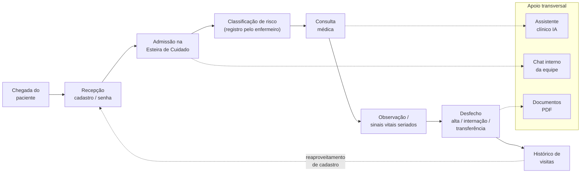

### 2.2 Módulos funcionais entregues

| Módulo | Estado | Rota frontend | Módulo backend |
|---|---|---|---|
| Autenticação e sessão | ✅ Implementado | `/` | `auth` |
| Cadastro e prontuário de pacientes | ✅ Implementado | `/main/pacientes` | `patients` |
| Sinais vitais seriados + gráficos | ✅ Implementado | `/main` | `sinais-vitais` |
| Esteira de Cuidado (Kanban) | ✅ Implementado | `/main/alertas` | `fila` |
| Triagem mobile | ✅ Implementado | `/mobile` | `fila`, `patients` |
| Assistente clínico de IA + áudio | ✅ Implementado | `/main/monitor` | `ai` |
| Chat interno tempo real | ✅ Implementado | `/chat` | `chat` |
| Histórico de visitas | ✅ Implementado | `/main/pacientes` (aba) | `visitas` |
| Exportação de prontuário PDF | ✅ Implementado (client-side) | `/main/exportar` | — |
| Política de dados / termos LGPD | ✅ Implementado | `/main/politica` | — |
| Notificações persistentes | ⛔ Não implementado | — | — |
| PDF server-side | ⛔ Não implementado | — | — |
| Trilha de auditoria (`audit_logs`) | ⛔ Não implementado | — | — |

---

## 3. Stakeholders e Atores

| Ator | Tipo | Papel no sistema | Responsabilidade principal |
|---|---|---|---|
| Recepcionista | Humano primário | `recepcionista` | Cadastro reduzido, emissão de senha, admissão na fila |
| Enfermeiro | Humano primário | `enfermeiro` | Registro da classificação de risco, registro de sinais vitais |
| Médico | Humano primário | `medico` | Consulta, conduta, desfecho, remoção da fila |
| Coordenação / Gestão | Humano secundário | — | Consome indicadores e histórico (via prontuário/PDF) |
| Groq API | Sistema externo | — | LLM de apoio clínico e transcrição de fala (Whisper) |
| PostgreSQL | Sistema externo | — | Persistência transacional |

### 3.1 Matriz de permissões (RBAC efetiva no código)

| Operação | Médico | Enfermeiro | Recepcionista | Origem da regra |
|---|:--:|:--:|:--:|---|
| `POST /login` | ✅ | ✅ | ✅ | `@Public()` |
| Listar pacientes | ✅ | ✅ | ✅ | `@Roles` no controller |
| Criar paciente | ✅ | ✅ | ✅ | `@Roles` no controller |
| Ver prontuário detalhado | ✅ | ✅ | ⛔ | `@Roles('medico','enfermeiro')` |
| Editar paciente | ✅ | ✅ | ⛔ | `@Roles('medico','enfermeiro')` |
| Registrar sinais vitais | ✅ | ✅ | ⛔ | `@Roles('medico','enfermeiro')` |
| Consultar sinais vitais | ✅ | ✅ | ⛔ | `@Roles('medico','enfermeiro')` |
| Listar fila | ✅ | ✅ | ✅ | `@Roles` no controller |
| Admitir na fila | ✅ | ✅ | ✅ | `@Roles` no controller |
| Avançar status na fila | ✅ | ✅ | ⛔ | `@Roles('medico','enfermeiro')` |
| Remover da fila | ✅ | ⛔ | ⛔ | `@Roles('medico')` |
| Histórico de visitas | ✅ | ✅ | ✅ | ⚠️ apenas JWT — sem `@Roles` |
| Fechar visita | ✅ | ✅ | ✅ | ⚠️ apenas JWT — sem `@Roles` |
| Assistente de IA | ✅ | ✅ | ⛔ | `@Roles('medico','enfermeiro')` |
| Chat interno | ✅ | ✅ | ✅ | Apenas JWT (por decisão de projeto) |

> ⚠️ As duas linhas de visitas são desvios de política documentados em [DEB-02](#13-débito-técnico-e-defeitos-identificados).

---

## 4. Requisitos

### 4.1 Requisitos Funcionais

| ID | Requisito | Prioridade | Ator | Verificação no código |
|---|---|:--:|---|---|
| RF-01 | Autenticar profissional por e-mail e senha, retornando token JWT com `id`, `nome`, `role` | Alta | Todos | `auth.service.ts` |
| RF-02 | Limitar tentativas de login a 10 por 15 min por IP em produção | Alta | — | `auth.controller.ts` (`@Throttle`) |
| RF-03 | Encerrar sessão automaticamente ao expirar o token | Alta | Todos | `services/api.ts` (interceptors) |
| RF-04 | Cadastrar paciente exigindo **somente o nome**; CPF (11 dígitos, único quando informado), idade, sexo e demais campos são opcionais; com *Nome desconhecido* o sistema grava o nome provisório "Paciente não identificado (#xxxx)" e marca `nome_provisorio` | Alta | Todos | `create-patient.service.ts`, `create-patient.dto.ts` |
| RF-05 | Impedir cadastro duplicado por CPF quando o CPF é informado (vários pacientes sem CPF são permitidos) | Alta | Todos | `create-patient.service.ts` |
| RF-06 | Exibir prontuário com dados pessoais, alergias, medicamentos e anamnese | Alta | Médico, Enfermeiro | `show-patient.service.ts` |
| RF-07 | Atualizar parcialmente o prontuário (corrigir o nome retira a marca de nome provisório e atualiza, na mesma transação, a cópia de nome e idade na esteira) | Média | Médico, Enfermeiro | `update-patient.service.ts` |
| RF-08 | Registrar medição de sinais vitais (FC, SpO₂, PA, temperatura) com marca temporal | Alta | Médico, Enfermeiro | `create-sinais-vitais.service.ts` |
| RF-09 | Retornar as 12 medições mais recentes para o painel | Alta | Médico, Enfermeiro | `get-current-vitals.service.ts` |
| RF-10 | Retornar histórico completo de sinais vitais | Média | Médico, Enfermeiro | `get-vitals-history.service.ts` |
| RF-11 | Classificar automaticamente o estado clínico em `critical`/`warning`/`normal` a partir da última medição | Alta | Médico, Enfermeiro | `utils/vitalStatus.ts` |
| RF-12 | Admitir paciente na Esteira de Cuidado gerando senha de atendimento | Alta | Todos | `create-fila.service.ts` |
| RF-13 | Impedir que o mesmo paciente ocupe duas posições na fila | Alta | Todos | `create-fila.service.ts` |
| RF-14 | Avançar o paciente pelos estados do fluxo de atendimento | Alta | Médico, Enfermeiro | `update-fila.service.ts` |
| RF-15 | Registrar a classificação de risco atribuída pelo enfermeiro (5 cores, decisão de projeto do protótipo) | Alta | Enfermeiro | `Alerts`, `MobileTriage` |
| RF-16 | Remover paciente da fila | Média | Médico | `delete-fila.service.ts` |
| RF-17 | Abrir visita automaticamente ao admitir o paciente na fila | Alta | — | `create-fila.service.ts` |
| RF-18 | Fechar visita registrando desfecho, alta e gravidade | Alta | — | `close-visita.service.ts` |
| RF-19 | Reutilizar visita ativa em vez de duplicar registro | Alta | — | `create-visita.service.ts` |
| RF-20 | Listar histórico de visitas do paciente com total | Média | Médico, Enfermeiro | `list-visitas-by-patient.service.ts` |
| RF-21 | Consultar assistente clínico de IA com contexto do paciente | Média | Médico, Enfermeiro | `clinical-chat.service.ts` |
| RF-22 | Destacar risco de alergia nas condutas sugeridas pela IA | Alta | Médico, Enfermeiro | `buildSystemPrompt()` |
| RF-23 | Transcrever áudio (até 25 MB) para texto em português | Média | Médico, Enfermeiro | `audio-transcription.service.ts` |
| RF-24 | Listar contatos internos (todos os usuários exceto o próprio) | Média | Todos | `list-contacts.service.ts` |
| RF-25 | Manter conversa de grupo geral com todos os profissionais | Média | Todos | migration `CreateChat` |
| RF-26 | Abrir ou recuperar conversa direta 1:1 idempotentemente | Média | Todos | `open-direct-conversation.service.ts` |
| RF-27 | Entregar mensagem em tempo real a todos os participantes | Alta | Todos | `chat.gateway.ts` |
| RF-28 | Marcar mensagem como `normal` ou `urgente` | Baixa | Todos | `send-message.dto.ts` |
| RF-29 | Contar mensagens não lidas por conversa | Média | Todos | `typeorm-chat.repository.ts` |
| RF-30 | Bloquear leitura/envio a não participante da conversa | Alta | — | `list-messages.service.ts`, `send-message.service.ts` |
| RF-31 | Manter mensagens imutáveis (sem update/delete) | Alta | — | `message.entity.ts` (por design) |
| RF-32 | Exportar prontuário do paciente em PDF | Média | Médico, Enfermeiro | `pages/ExportPDF` |
| RF-33 | Emitir Guia de Alta / Prescrição em PDF | Média | Médico | `Alerts/index.tsx` |
| RF-34 | Exigir aceite de termos de uso no primeiro acesso | Alta | Todos | `TermosUsoModal` |
| RF-35 | Disponibilizar política de tratamento de dados com download | Alta | Todos | `PoliticaDados`, `gerarPDFPolitica.ts` |
| RF-36 | Oferecer trilha de triagem otimizada para mobile | Média | Enfermeiro, Recepcionista | `MobileTriage`, `useMobile` |
| RF-37 | Filtrar navegação lateral conforme o papel do usuário | Alta | Todos | `SideBar` + `RoleRoute` |

### 4.2 Requisitos Não Funcionais

| ID | Categoria | Requisito | Como é atendido |
|---|---|---|---|
| RNF-01 | Segurança | Autenticação obrigatória por padrão; exceções explícitas | `JwtAuthGuard` como `APP_GUARD` global + `@Public()` |
| RNF-02 | Segurança | Autorização por papel aplicada de forma declarativa | `RolesGuard` global + `@Roles()` |
| RNF-03 | Segurança | Senhas armazenadas com hash bcrypt, custo 12 | `seed.ts`, `bcrypt.compare` |
| RNF-04 | Segurança | Falha rápida no boot se `SECRET_KEY` ausente | `env.validation.ts` |
| RNF-05 | Segurança | Cabeçalhos HTTP endurecidos | `helmet()` |
| RNF-06 | Segurança | CORS restrito por ambiente (allowlist em produção) | `main.ts` |
| RNF-07 | Segurança | Payload limitado a 10 KB (mitigação de DoS) | `json({ limit: '10kb' })` |
| RNF-08 | Segurança | Rejeição de campos desconhecidos no corpo da requisição | `ValidationPipe({ whitelist: true })` |
| RNF-09 | Segurança | Validação de UUID em todos os parâmetros de rota | `ParseUUIDPipe` |
| RNF-10 | Segurança | Rate limit global de 100 req / 15 min | `ThrottlerModule.forRoot` |
| RNF-11 | Segurança | Autenticação do WebSocket no handshake | `chat.gateway.ts` `handleConnection` |
| RNF-12 | Manutenibilidade | Separação em 4 camadas por módulo (domain/application/infrastructure/presentation) | Estrutura de `src/modules/*` |
| RNF-13 | Manutenibilidade | Inversão de dependência via tokens de repositório | `PATIENTS_REPOSITORY`, `CHAT_REPOSITORY`, etc. |
| RNF-14 | Manutenibilidade | Tipagem estrita ponta a ponta | TypeScript 5.7 (back) / 5.9 (front) |
| RNF-15 | Portabilidade | Banco versionado exclusivamente por migrations | `synchronize: false` |
| RNF-16 | Portabilidade | Suporte a `DATABASE_URL` (nuvem) ou `DB_*` (local) | `typeorm.config.ts` |
| RNF-17 | Desempenho | Consultas frequentes indexadas | `idx_messages_conversation_created`, `IDX_visitas_*` |
| RNF-18 | Desempenho | Paginação implícita por limite nas listagens de mensagens (100) e vitais (12) | Services correspondentes |
| RNF-19 | Desempenho | Denormalização de `sender_nome`/`sender_role` para evitar join no chat | `messages` (migration) |
| RNF-20 | Usabilidade | Interface responsiva com trilha mobile dedicada | `AppShell`, `useMobile` |
| RNF-21 | Usabilidade | Identidade visual e tipografia centralizadas em tema | `theme.ts` |
| RNF-22 | Confiabilidade | Reconexão automática do WebSocket com backoff | `chatService.ts` (`reconnectionDelayMax: 10000`) |
| RNF-23 | Confiabilidade | Envio de mensagem com ACK e degradação para REST | `chatService.sendMessage` |
| RNF-24 | Confiabilidade | Deduplicação de mensagens entre ACK e broadcast | `seenIds: Set<string>` |
| RNF-25 | Confiabilidade | Timeout de 30 s nas chamadas ao provedor de IA | `axios timeout` |
| RNF-26 | Conformidade | Nenhum dado de paciente trafega por plataforma de terceiros | Decisão de arquitetura (Telegram descartado) |
| RNF-27 | Conformidade | Aceite de termos e política de dados acessível | `TermosUsoModal`, `PoliticaDados` |
| RNF-28 | Observabilidade | Log de SQL habilitado fora de produção | `logging: !isProduction` |

---

## 5. Casos de Uso

### 5.1 Diagrama de casos de uso

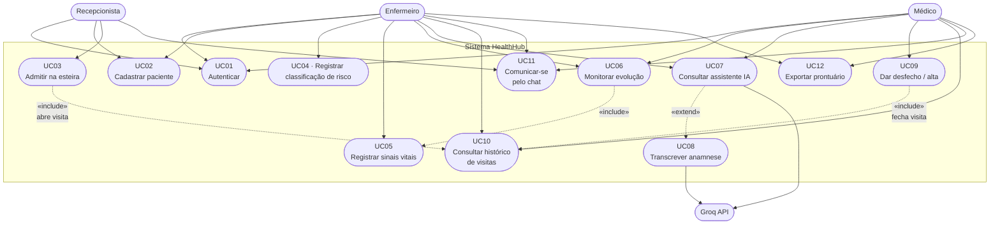

### 5.2 Especificação detalhada — UC03 · Admitir paciente na Esteira de Cuidado

| Item | Descrição |
|---|---|
| **Identificador** | UC03 |
| **Atores** | Recepcionista, Enfermeiro, Médico |
| **Objetivo** | Colocar um paciente cadastrado na fila de atendimento e abrir seu registro de visita |
| **Pré-condições** | Usuário autenticado com token válido; paciente existente no cadastro |
| **Pós-condições** | Registro em `fila_pacientes` com status `Aguardando Triagem`; visita ativa em `visitas` com desfecho `Em Atendimento` |
| **Gatilho** | Chegada física do paciente à recepção |

**Fluxo principal**

1. Usuário abre a Esteira de Cuidado (`/main/alertas`) ou a triagem mobile.
2. Usuário aciona *Admitir* e o sistema lista todos os pacientes do banco — inclusive os que já receberam alta.
3. Usuário seleciona o paciente.
4. O cliente envia a hora local de chegada; a senha sequencial (`PR-001`, `PR-002`...) é **gerada pelo servidor**, de forma atômica (o campo `senha` enviado pelo cliente é ignorado).
5. O sistema envia `POST /fila` com `paciente_id`, `nome`, `idade`, `senha`, `chegada`, `status`.
6. O backend valida o DTO e verifica ausência prévia do paciente na fila.
7. O backend persiste a entrada na fila.
8. O backend abre uma visita (ou reaproveita a visita ativa, se houver).
9. O sistema retorna a entrada e o Kanban recebe o cartão na coluna *Aguardando Triagem*.

**Fluxos alternativos**

| Código | Condição | Tratamento |
|---|---|---|
| A1 | Paciente já está na fila (inclui admissões simultâneas do mesmo paciente) | `409` — "Paciente já está na fila de atendimento." |
| A2 | `paciente_id` não é UUID | `400` — falha de validação do DTO |
| A3 | Token expirado | `401` + logout automático no frontend |
| A4 | Paciente ainda não cadastrado | Estende para UC02 (cadastro na hora) |
| A5 | Paciente possui visita ativa aberta | Visita existente é reutilizada, sem duplicar registro |

### 5.3 Especificação detalhada — UC04 · Registrar classificação de risco

| Item | Descrição |
|---|---|
| **Identificador** | UC04 |
| **Ator** | Enfermeiro |
| **Objetivo** | Classificar a gravidade do paciente e definir a prioridade de atendimento |
| **Pré-condições** | Paciente na fila com status `Aguardando Triagem` |
| **Pós-condições** | Status `Aguardando Atendimento` e `gravidade` gravada |

**Fluxo principal**

1. Enfermeiro move o cartão para *Em Triagem (Enfermeiro)*.
2. Enfermeiro registra sinais vitais (UC05).
3. Enfermeiro escolhe um dos cinco níveis de gravidade.
4. O sistema envia `PUT /fila/:id` com `status` e `gravidade`.
5. O cartão passa a *Aguardando Atendimento* com a cor da gravidade.

**Regras de negócio**

A escala tem cinco cores, em ordem de prioridade: Vermelho, Laranja, Amarelo, Verde e Azul. As cinco cores são uma decisão de projeto do protótipo (compatível com a recomendação mínima de quatro níveis do manual do Ministério da Saúde de 2009), não um padrão oficial. A cor é escolhida manualmente pelo enfermeiro; o sistema não classifica, não sugere prioridade e não controla prazos, e não há tempo-alvo associado às cores.

---

## 6. Arquitetura do Sistema

### 6.1 Estilo arquitetural

| Aspecto | Decisão |
|---|---|
| Estilo geral | Cliente-servidor em duas camadas de execução, comunicação REST + WebSocket |
| Organização do backend | **Modular monolith** com **Clean Architecture** por módulo |
| Padrões aplicados | Repository, Dependency Injection, Service Layer, DTO, Guard/Interceptor (AOP), Gateway, Singleton (`chatService`), Observer (listeners de mensagem), Provider/Context (frontend) |
| Direção das dependências | `presentation → application → domain ← infrastructure` |
| Acoplamento com ORM | Isolado na camada `infrastructure` por trás de interfaces em `domain` |

### 6.2 Diagrama de contexto (C4 — Nível 1)

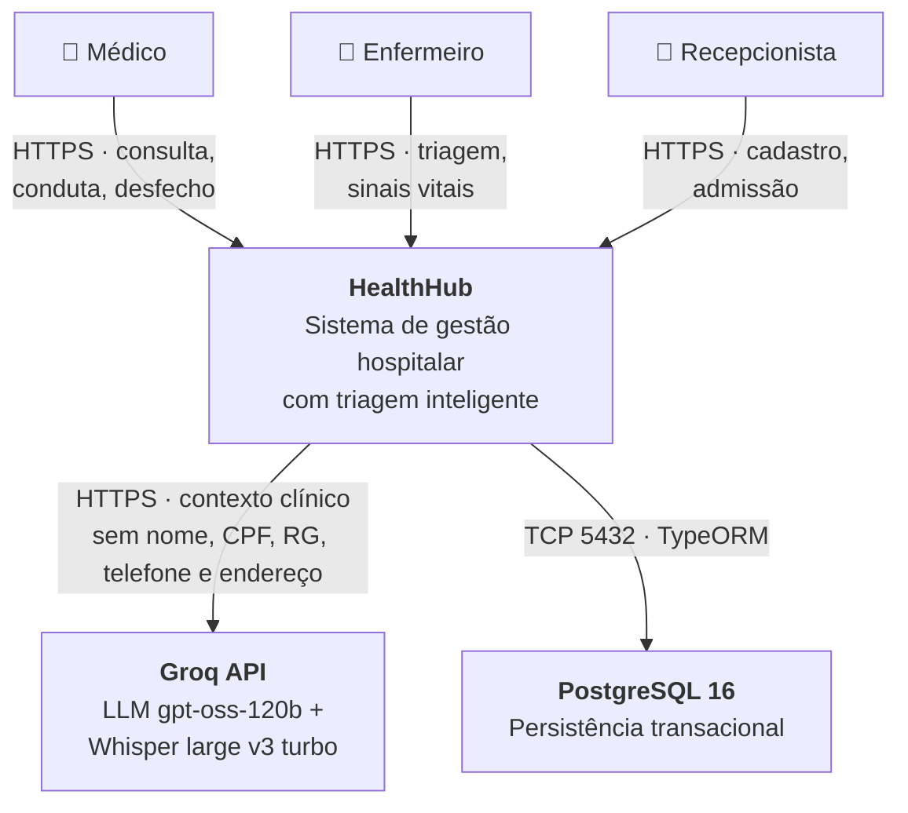

### 6.3 Diagrama de contêineres (C4 — Nível 2)

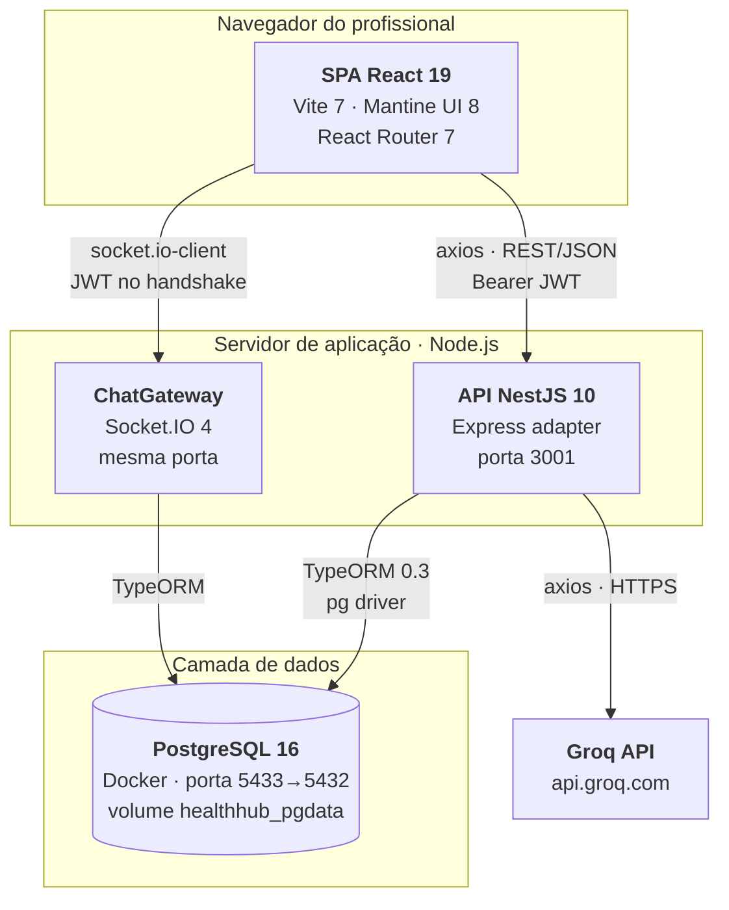

### 6.4 Diagrama de componentes do backend (C4 — Nível 3)

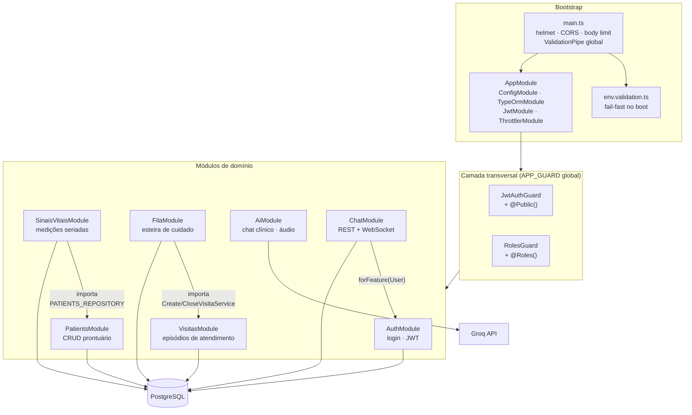

### 6.5 Camadas internas de um módulo

Todos os módulos de domínio seguem exatamente a mesma decomposição. Exemplo com `patients`:

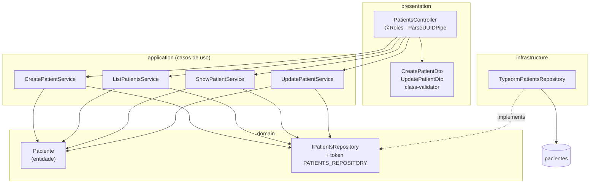

**Consequência arquitetural:** a camada `application` nunca importa TypeORM. Trocar o ORM ou o banco exige reescrever apenas `infrastructure/`.

### 6.6 Arquitetura do frontend

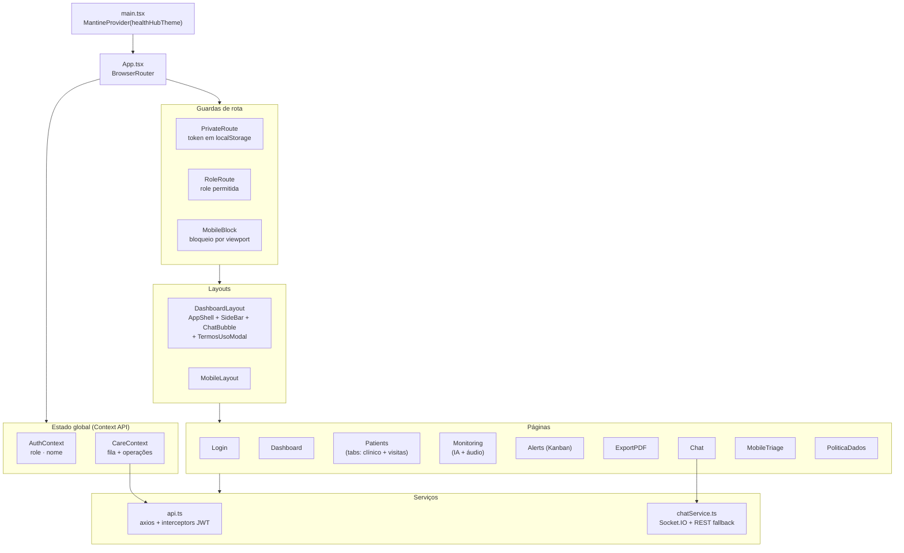

**Padrão de segurança no cliente:** o interceptor de requisição decodifica o JWT, compara `exp` com o relógio local e, se expirado, limpa `localStorage` e redireciona para `/` antes de a requisição sair. O interceptor de resposta repete a limpeza em qualquer `401` que não venha de `/login`.

---

## 7. Modelo de Domínio e Diagrama de Classes

### 7.1 Diagrama de classes — entidades de domínio

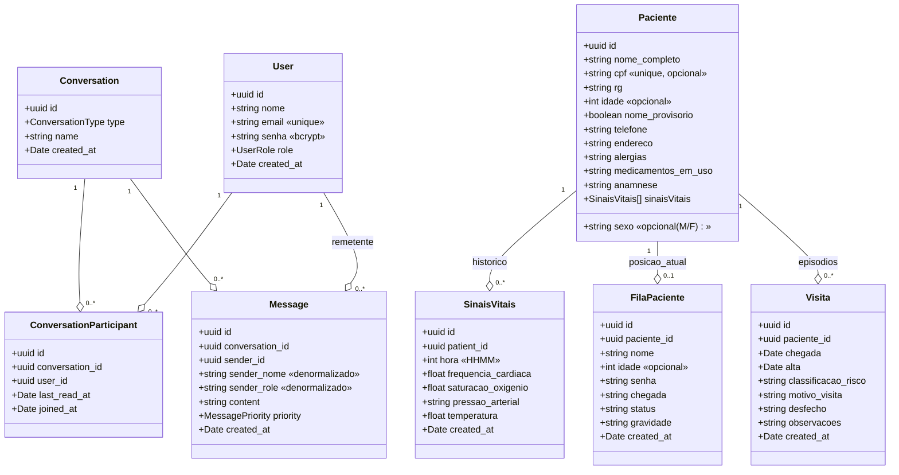

### 7.2 Diagrama de classes — camada de aplicação do módulo Fila

Ilustra a inversão de dependência e o acoplamento entre módulos (`fila` → `visitas`):

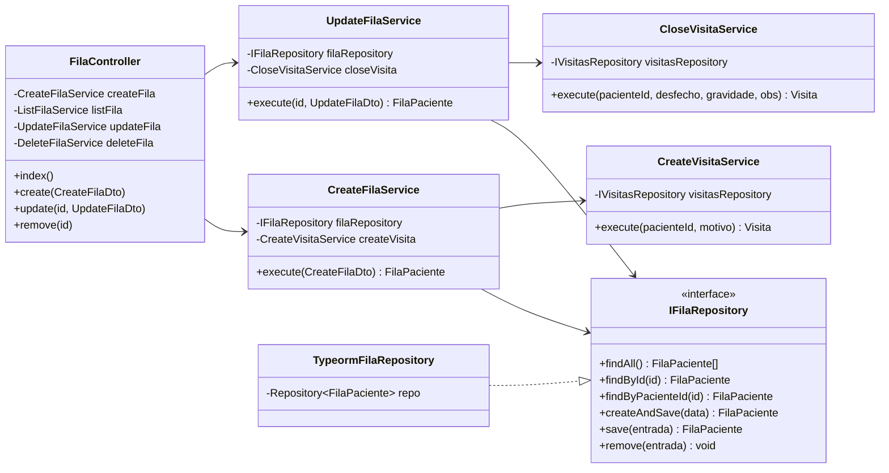

### 7.3 Regras de negócio invariantes

| ID | Invariante | Onde é garantida |
|---|---|---|
| RN-01 | CPF é único no cadastro de pacientes **quando informado** (vários cadastros sem CPF são permitidos) | `UNIQUE` no banco (NULL não colide) + verificação em `CreatePatientService` |
| RN-02 | Um paciente ocupa no máximo uma posição na fila | `findByPacienteId` em `CreateFilaService` |
| RN-03 | Um paciente possui no máximo uma visita ativa | `findActiveByPacienteId` em `CreateVisitaService` |
| RN-04 | Visita ativa ⇔ `alta IS NULL AND desfecho = 'Em Atendimento'` | Cláusula do repositório de visitas |
| RN-05 | Mensagens são imutáveis | Ausência deliberada de operações de update/delete |
| RN-06 | Só participante lê ou escreve em conversa | `isParticipant()` em todos os casos de uso do chat |
| RN-07 | Toda conversa do tipo `group` inclui implicitamente todos os usuários | `isParticipant` retorna `true` para `type = 'group'` |
| RN-08 | Conversa direta entre A e B é única | `findDirectConversation` antes de criar |
| RN-09 | `last_read_at` usa o relógio do banco, não do Node | `set({ last_read_at: () => 'now()' })` — evita erro de contagem por fuso |
| RN-10 | Remetente já leu sua própria mensagem | `markAsRead` no fim de `SendMessageService` |
| RN-11 | Exclusão de paciente propaga em cascata para vitais, fila e visitas | `ON DELETE CASCADE` nas FKs |
| RN-12 | Só o **nome** é obrigatório no cadastro; sem nome, o sistema grava "Paciente não identificado (#xxxx)" com `nome_provisorio = true`, até alguém corrigir o nome | `create-patient.dto.ts`, `CreatePatientService`, `UpdatePatientService` |
| RN-13 | Corrigir nome ou idade de quem está na esteira atualiza a cópia da esteira **na mesma transação** e avisa os clientes (`fila:changed`) | `saveSincronizandoFila` em `TypeormPatientsRepository` |

### 7.4 Regra de negócio: cadastro mínimo (só o nome)

**Regra.** O único campo obrigatório do cadastro de paciente é o nome. CPF, RG, idade, sexo, telefone, endereço, alergias, medicamentos e anamnese são opcionais; um campo opcional vazio é gravado como `NULL` e o formato (CPF com 11 dígitos, idade de 0 a 150, sexo `M`/`F`, telefone com 10 ou 11 dígitos) só é validado quando há valor. Se o nome não é conhecido (por exemplo, paciente inconsciente), o cadastro oferece *Nome desconhecido*: o servidor gera o id do paciente e grava o nome "Paciente não identificado (#xxxx)", em que `xxxx` são os quatro primeiros caracteres do id, e marca `nome_provisorio = true`. Os quatro caracteres não precisam ser únicos: o nome não tem restrição de unicidade e a identificação real é o id.

**Justificativa.** Em urgência o paciente não precisa ter todos os dados disponíveis para ser atendido; o cadastro começa só com o nome (ou com um nome provisório) e os demais dados são completados depois, durante o atendimento.

**Riscos e mitigação.** A regra aumenta o risco de registros duplicados (o CPF, que impedia duplicidade, pode faltar), de registros incompletos e de identificação incorreta. O nome provisório mitiga o último: a marca fica visível (selo "Nome provisório") na lista de pacientes, na esteira, no painel, na admissão, no chat e nos PDFs até a correção, e o nome pode ser corrigido a qualquer momento pela edição do paciente (médico e enfermeiro; a recepção continua sem permissão de editar). A duplicidade só é detectada pelo CPF quando ele é informado.

---

## 8. Modelo de Dados

### 8.1 DER Conceitual (modelo de entidades de negócio)

Visão de alto nível, sem atributos nem chaves — apenas as entidades do domínio hospitalar e como se relacionam.

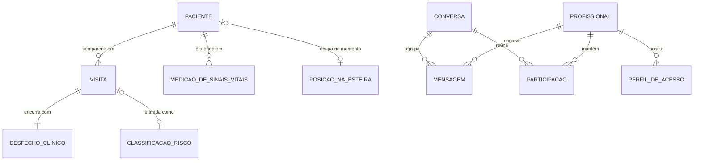

**Leitura das cardinalidades conceituais**

| Relacionamento | Cardinalidade | Regra de negócio correspondente |
|---|---|---|
| Paciente → Visita | 1 : 0..N | Um paciente acumula vários episódios ao longo do tempo; no máximo **um** ativo por vez (RN-03) |
| Paciente → Medição | 1 : 0..N | Histórico seriado permite ver evolução, não só uma foto |
| Paciente → Posição na esteira | 1 : 0..1 | Um paciente ocupa no máximo uma posição na fila (RN-02) |
| Visita → Desfecho | 1 : 1 | Toda visita tem desfecho; nasce como `Em Atendimento` |
| Visita → Classificação | 1 : 0..1 | A gravidade só existe depois da triagem |
| Profissional → Mensagem | 1 : 0..N | Autoria imutável, base do rastro auditável (RN-05) |
| Conversa ↔ Profissional | N : N (via Participação) | Resolvida pela entidade associativa `PARTICIPACAO` |

> ⚠️ No modelo conceitual, `DESFECHO_CLINICO` e `CLASSIFICACAO_RISCO` aparecem como entidades porque são **domínios de valor com semântica clínica**. Na implementação atual foram reduzidos a colunas `varchar` sem tabela de referência nem `CHECK` — desvio registrado em [DEB-19](#13-débito-técnico-e-defeitos-identificados).

### 8.2 DER Lógico completo (esquema implementado)

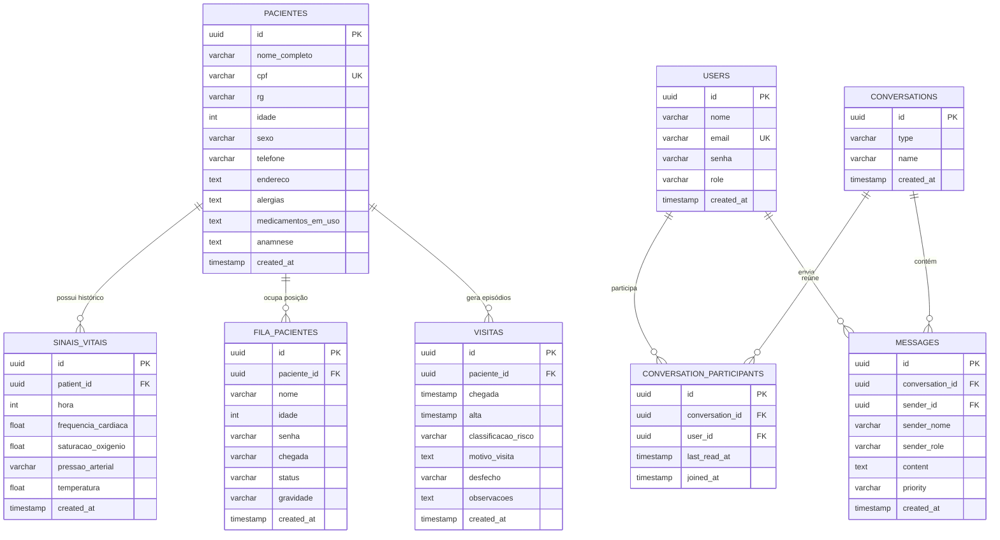

### 8.3 DER por subsistema

O esquema divide-se em dois agregados que **não compartilham nenhuma chave estrangeira entre si**. Essa separação é intencional: o subsistema de comunicação pode evoluir (ou ser extraído para outro serviço) sem tocar no núcleo assistencial.

#### 8.3.1 Subsistema Assistencial — núcleo clínico

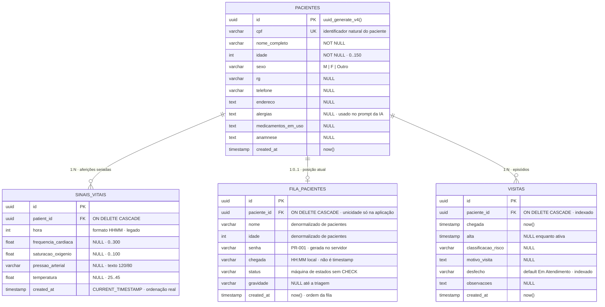

**Ponto de atenção do modelo:** `FILA_PACIENTES` guarda `nome` e `idade` copiados de `PACIENTES`. É denormalização **não justificada** (diferente da de `MESSAGES`, que é deliberada) — a fila poderia obter esses campos por join, e a cópia permite divergência se o cadastro for corrigido durante o atendimento. Ver [DEB-20](#13-débito-técnico-e-defeitos-identificados).

#### 8.3.2 Subsistema de Comunicação — chat interno

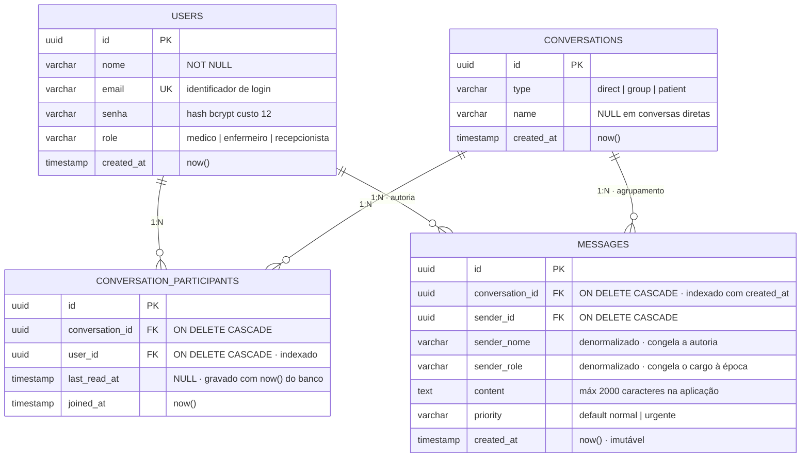

`CONVERSATION_PARTICIPANTS` é a **entidade associativa** que resolve o N:N entre `USERS` e `CONVERSATIONS`, e carrega o atributo próprio `last_read_at` — é ele que permite calcular mensagens não lidas sem tabela extra de leitura por mensagem.

**Exceção de modelagem:** conversas do tipo `group` têm participação **implícita**. `isParticipant()` retorna verdadeiro para qualquer usuário sem consultar `CONVERSATION_PARTICIPANTS`, e a linha só é criada sob demanda para armazenar `last_read_at` (ADR-06). Ou seja, a integridade referencial descreve o caso `direct`; o caso `group` é resolvido em código.

### 8.4 Modelo físico — constraints e integridade

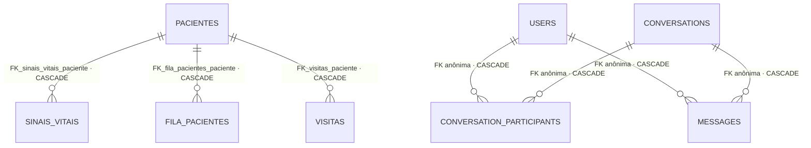

| Constraint | Tabela | Definição | Efeito |
|---|---|---|---|
| `PK` (7×) | todas | `uuid` com `uuid_generate_v4()` | Extensão `uuid-ossp` habilitada por migration |
| `UK cpf` | `pacientes` | `UNIQUE` (coluna anulável: vários `NULL` não colidem) | Garante RN-01 no banco, não só na aplicação |
| `UK email` | `users` | `UNIQUE` | Identificador de login |
| `UNIQUE (conversation_id, user_id)` | `conversation_participants` | composta | Impede participação duplicada |
| `FK_sinais_vitais_paciente` | `sinais_vitais` | `CASCADE` | Excluir paciente remove o histórico de aferições |
| `FK_fila_pacientes_paciente` | `fila_pacientes` | `CASCADE` | Excluir paciente o retira da esteira |
| `FK_visitas_paciente` | `visitas` | `CASCADE` | Excluir paciente remove os episódios |
| FKs do chat (4×) | `conversation_participants`, `messages` | `CASCADE` | Excluir conversa ou usuário limpa dependências |
| `DEFAULT 'Em Atendimento'` | `visitas.desfecho` | default | Sentinela de visita aberta |
| `DEFAULT 'normal'` | `messages.priority` | default | Prioridade padrão |

**Ausências deliberadas ou pendentes**

| O que não existe | Onde a regra vive hoje | Risco |
|---|---|---|
| `CHECK` em `fila_pacientes.status` | `PatientStatus` no TypeScript | Escrita direta no banco aceita status inválido |
| `CHECK` em `visitas.desfecho` / `classificacao_risco` | `@IsIn` no `CloseVisitaDto` | Idem |
| `CHECK` em `users.role` | Tipo `UserRole` | Idem |
| `UNIQUE (paciente_id)` em `fila_pacientes` | `findByPacienteId` no service | Corrida entre duas admissões simultâneas pode duplicar |
| Índice único parcial de visita ativa | `findActiveByPacienteId` | Corrida pode abrir duas visitas ativas |
| `NOT NULL` explícito em colunas obrigatórias | Inferido pelo TypeORM | — |

> Um `CREATE UNIQUE INDEX ... ON visitas (paciente_id) WHERE alta IS NULL` transformaria RN-03 em garantia do banco, eliminando a janela de corrida.

### 8.5 Normalização

| Forma normal | Situação | Observação |
|---|---|---|
| **1FN** | ✅ Atendida | Todos os atributos são atômicos — com a ressalva de `pressao_arterial`, que é um valor composto (sistólica/diastólica) armazenado como texto |
| **2FN** | ✅ Atendida | Todas as chaves primárias são simples (`uuid`); não há dependência parcial possível |
| **3FN** | ⚠️ Violada de propósito em 2 pontos | `messages.sender_nome`/`sender_role` dependem de `sender_id`, não da PK; `fila_pacientes.nome`/`idade` dependem de `paciente_id` |

**As duas violações têm naturezas opostas:**

- **`messages`** — denormalização **correta**. A mensagem é um registro histórico imutável: se o cargo do profissional mudar amanhã, a mensagem de ontem deve continuar mostrando o cargo da época. Congelar o dado é o comportamento desejado para auditoria (ADR-04), e ainda elimina o join na listagem.
- **`fila_pacientes`** — denormalização **acidental**. A fila é registro efêmero e o nome do paciente não deve ser congelado: corrigir um nome errado no cadastro durante o atendimento não propaga para o cartão do Kanban.

### 8.6 Dicionário de dados — decisões relevantes

| Tabela | Coluna | Tipo | Nota de projeto |
|---|---|---|---|
| `sinais_vitais` | `hora` | `int` | Formato `HHMM` (ex.: `1435`) — herança do sistema legado, preservada por compatibilidade |
| `sinais_vitais` | `pressao_arterial` | `varchar` | Texto porque a medição é composta (`120/80`), não escalar |
| `fila_pacientes` | `chegada` | `varchar` | Hora local formatada `HH:MM` gerada no cliente — **não** é timestamp |
| `fila_pacientes` | `status` | `varchar` | Máquina de estados aplicada apenas na aplicação, sem `CHECK` no banco |
| `visitas` | `desfecho` | `varchar` | Default `'Em Atendimento'`; sentinela de visita aberta |
| `visitas` | `alta` | `timestamp` | `NULL` enquanto a visita está ativa |
| `messages` | `sender_nome`, `sender_role` | `varchar` | Denormalizados de propósito: mensagens são imutáveis, evita join na listagem |
| `conversation_participants` | `(conversation_id, user_id)` | `UNIQUE` | Impede participação duplicada |
| `conversations` | linha semente | — | `('group', 'Grupo Geral')` inserida pela migration |

### 8.7 Índices

| Índice | Tabela | Colunas | Consulta que atende |
|---|---|---|---|
| `idx_messages_conversation_created` | `messages` | `(conversation_id, created_at)` | Últimas 100 mensagens da conversa; última mensagem do resumo |
| `idx_participants_user` | `conversation_participants` | `(user_id)` | Conversas diretas do usuário logado |
| `IDX_visitas_paciente_id` | `visitas` | `(paciente_id)` | Histórico de visitas do paciente |
| `IDX_visitas_desfecho` | `visitas` | `(desfecho)` | Busca da visita ativa |

### 8.8 Evolução do esquema (migrations)

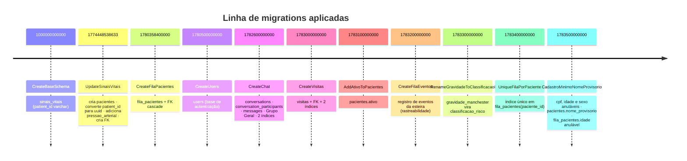

`synchronize` está desligado: **toda** mudança de esquema passa por migration versionada, o que garante reprodutibilidade entre ambientes.

---

## 9. Comportamento Dinâmico

### 9.1 Sequência — Autenticação e estabelecimento de sessão

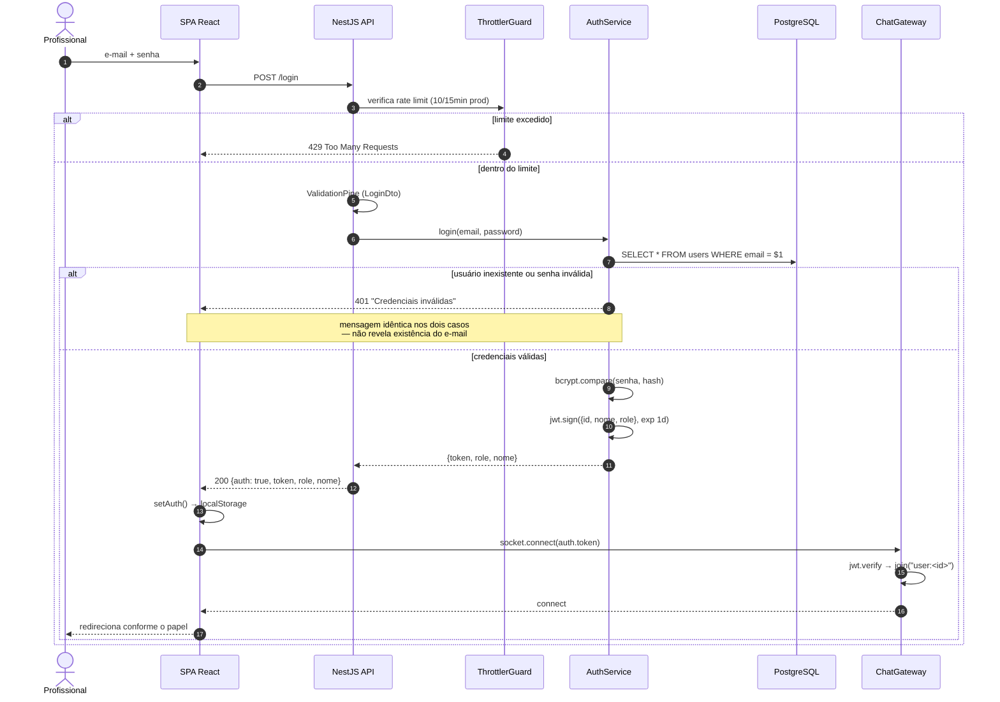

### 9.2 Sequência — Admissão na fila com abertura automática de visita

```mermaid
sequenceDiagram
    autonumber
    actor R as Recepcionista
    participant SPA as CareContext
    participant G as JwtAuthGuard + RolesGuard
    participant FC as FilaController
    participant CFS as CreateFilaService
    participant FR as FilaRepository
    participant CVS as CreateVisitaService
    participant VR as VisitasRepository
    participant DB as PostgreSQL

    R->>SPA: admitirPaciente(patient, senha)
    SPA->>G: POST /fila (Bearer JWT)
    G->>G: verify token · role ∈ {medico, enfermeiro, recepcionista}
    G->>FC: requisição autorizada
    FC->>FC: ValidationPipe (CreateFilaDto)
    FC->>CFS: execute(dto)
    CFS->>FR: admitirAtomico(dto, motivo_visita)
    Note over FR,DB: uma transação: pg_advisory_xact_lock; paciente já na fila?; senha = maior PR-NNN + 1; INSERT fila; visita ativa ou INSERT visitas; UPDATE pacientes.ativo
    alt já está na fila (ou violação do índice único UQ_fila_pacientes_paciente)
        CFS-->>SPA: 409 "Paciente já está na fila de atendimento."
    else livre
        FR-->>CFS: FilaPaciente (com a senha gerada)
        CFS-->>SPA: 201 FilaPaciente
        SPA->>SPA: atualiza estado local do Kanban
        SPA-->>R: cartão em "Aguardando Triagem"
    end
```

> ✅ **Integridade:** a admissão (fila, visita e reativação do paciente) roda em **uma transação**, com bloqueio da fila, senha gerada no servidor e índice único em `fila_pacientes(paciente_id)` (migration `1783400000000`). Admissões simultâneas não duplicam senha nem entrada (evidência: `evidencias_tcc/rodada_final/`). Isto resolve o ponto do [DEB-03](#13-débito-técnico-e-defeitos-identificados) para a admissão.

### 9.3 Sequência — Mensagem em tempo real com degradação para REST

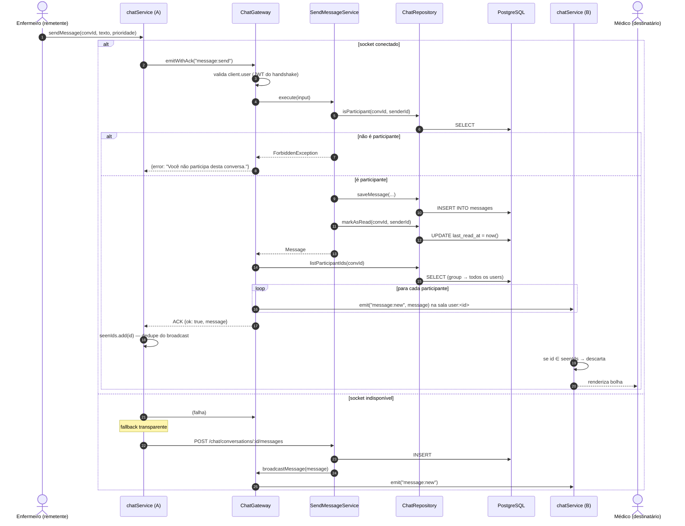

### 9.4 Sequência — Assistente clínico de IA com contexto do paciente

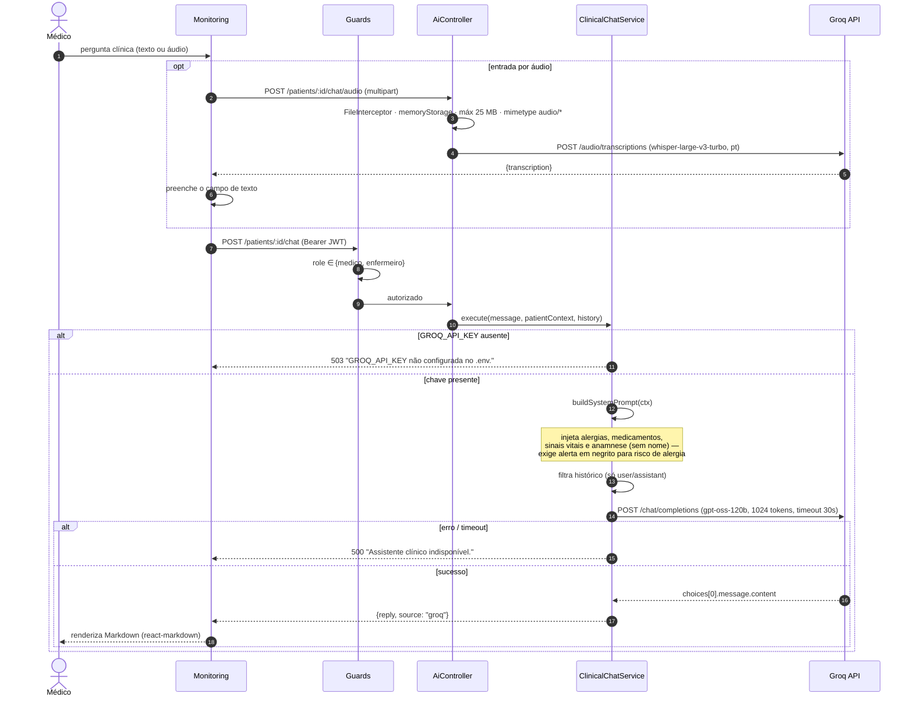

### 9.5 Máquina de estados — paciente na Esteira de Cuidado

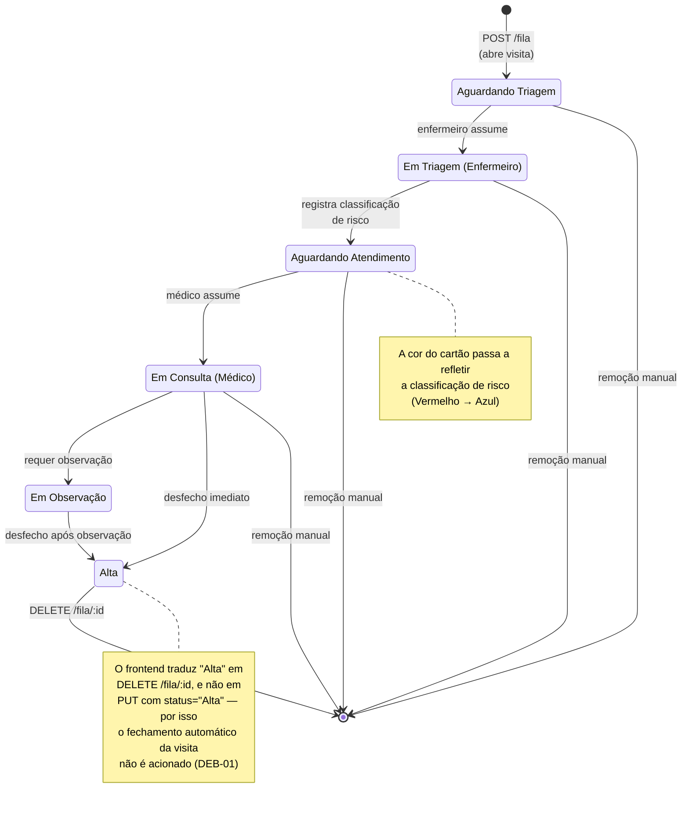

### 9.6 Máquina de estados — ciclo de vida da Visita

```mermaid
stateDiagram-v2
    [*] --> EmAtendimento : CreateVisitaService<br/>chegada = now()<br/>alta = NULL

    EmAtendimento : Em Atendimento (ativa)

    EmAtendimento --> EmAtendimento : nova admissão do<br/>mesmo paciente<br/>(reutiliza — idempotente)

    EmAtendimento --> Alta : CloseVisitaService
    EmAtendimento --> Internacao : CloseVisitaService
    EmAtendimento --> Transferencia : CloseVisitaService
    EmAtendimento --> SaidaVoluntaria : CloseVisitaService

    Alta --> [*]
    Internacao --> [*]
    Transferencia --> [*]
    SaidaVoluntaria --> [*]

    note right of EmAtendimento
        Visita ativa ⇔
        alta IS NULL
        AND desfecho = 'Em Atendimento'
    end note
```

### 9.7 Atividade — Classificação automática do estado clínico

Regra implementada em `utils/vitalStatus.ts` (frontend) e `calcular-metricas.ts` (backend, só o nível crítico), aplicada sobre a **última** medição. Os números e a fonte de cada um ficam em `config/limiaresSinaisVitais.ts` (frontend) e `config/limiares-sinais-vitais.ts` (backend). Desde a rodada 3 (05/11/2026) **todos os limiares têm fonte documental**:

| Sinal | Nível | Regra | Fonte do número |
|---|---|---|---|
| FC (bpm) | crítico | `< 60` ou `> 100` | POP.HC-UFTM-DENF.003 v6 (Ebserh, 2025), Anexo E (adulto, 60 a 100) |
| FC (bpm) | atenção | `> 90` | Critérios de SIRS (Bone et al., 1992); NEWS2 (RCP, 2017: 91 a 110 vale 1 ponto) |
| SpO₂ (%) | crítico | `< 92` | NEWS2 (RCP, 2017), escala 1: ≤ 91% vale 3 pontos |
| SpO₂ (%) | atenção | `< 95` | POP Anexo H (normal 95 a 100%); NEWS2: 94 a 95% vale 1 ponto |
| Temperatura (°C) | crítico | `>= 39,1` (antes: `> 38,5`) | POP Anexo F (febre alta, 39,1 a 40,0); NEWS2: ≥ 39,1 vale 2 pontos |
| Temperatura (°C) | atenção | `>= 37,8` | POP Anexo F (febre baixa, a partir de 37,8) |
| Pressão (mmHg) | crítico | PAS `<= 90` ou PAS `>= 180` ou PAD `>= 120` | NEWS2 e POP Anexo A (PAS ≤ 90); Posicionamento Luso-Brasileiro de Emergências Hipertensivas 2020 (SBC), Linha de cuidado da hipertensão (MS) e POP Anexo D (PAS ≥ 180 ou PAD ≥ 120) |
| Pressão (mmHg) | atenção | PAS 91 a 100 ou PAS `>= 140` ou PAD `>= 90` | NEWS2 e POP Anexo A (PAS 91 a 100); Diretrizes Brasileiras de Hipertensão 2020 (SBC), Quadro 3.4, e Linha de cuidado (MS) |

Os rótulos "atenção" e "crítico" são uma **convenção do projeto**; a fonte documenta o **número**. O nível do paciente é o **pior** entre os sinais (crítico vence atenção). Valor ausente ou `<= 0` é desconhecido. A pressão continua sendo **texto livre** (sem migração) e só gera alerta se tiver o formato `PAS/PAD` (aceita `120/80`, `120x80`, `120 / 80`; PAS e PAD de 30 a 300); formato inválido não gera alerta nem erro. O alerta de pressão reage a **uma** leitura e significa "pressão elevada ou baixa", não "hipertensão diagnosticada" (a diretriz exige medidas repetidas para o diagnóstico). Comparação com a versão anterior: a temperatura crítica subiu de `> 38,5` para `>= 39,1` (faixa de 38,6 a 39,0 passou de crítico para atenção) e a pressão passou a ter alerta; os demais valores não mudaram, só ganharam fonte. Detalhes e conferência das fontes: `evidencias_tcc/rodada_final_3/`.

```mermaid
flowchart TD
    A["Última medição<br/>de sinais vitais"] --> B{"Existe<br/>medição?"}
    B -->|"não"| U["unknown<br/>cinza"]
    B -->|"sim"| C{"SpO₂ < 92% ou FC < 60 ou > 100<br/>ou Temp >= 39,1 °C<br/>ou PAS <= 90, PAS >= 180, PAD >= 120?"}
    C -->|"sim"| CR["critical<br/>vermelho"]
    C -->|"não"| D{"SpO₂ < 95% ou FC > 90<br/>ou Temp >= 37,8 °C<br/>ou PAS 91-100, PAS >= 140, PAD >= 90?"}
    D -->|"sim"| W["warning<br/>amarelo"]
    D -->|"não"| E{"Algum valor<br/>válido?"}
    E -->|"sim"| N["normal<br/>verde"]
    E -->|"não"| U
```

Cada métrica também possui avaliador individual (`spo2Status`, `fcStatus`, `tempStatus`, `pressaoStatus`) usado nos cartões do painel, com os mesmos limiares.


